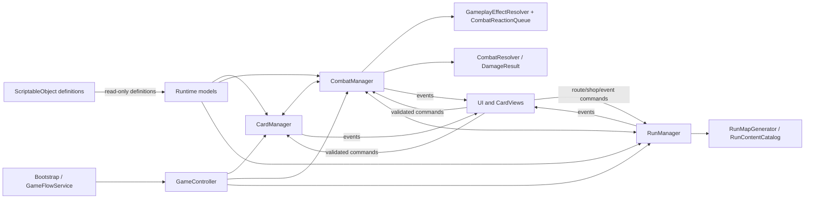
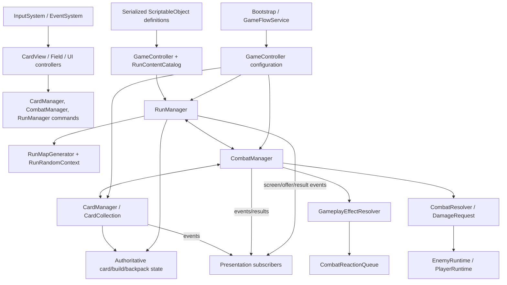
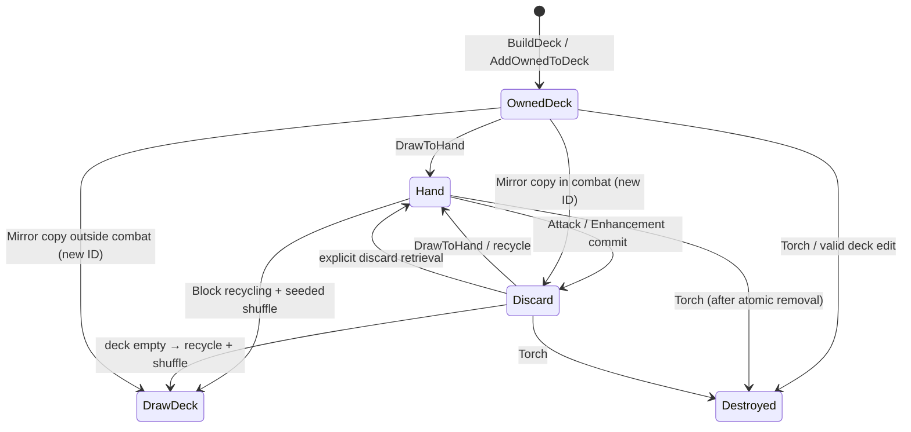
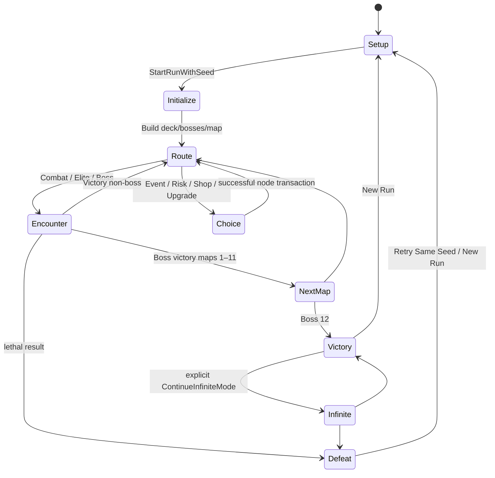
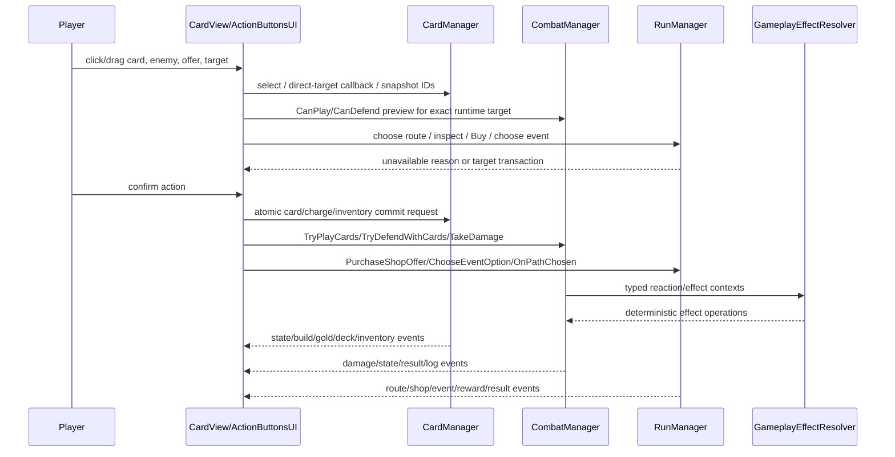
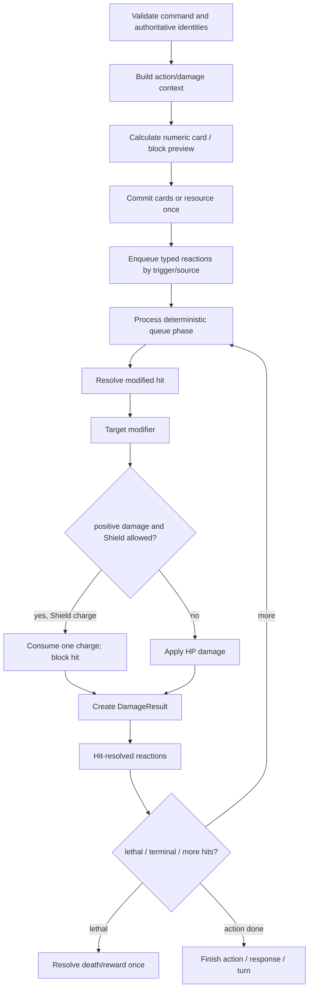

# Dealbreak Complete Technical Reference

> **Internal rename update (2026-10-13):** The runtime assembly is now `Dealbreak.Runtime`; Gear uses `GearData`/`GearRuntimeInstance`, and progression APIs use Headliner. This document is a historical implementation snapshot; see `Docs/Dealbreak_Internal_Rebranding_Report.md` for the current API and compatibility boundary.

- **Purpose:** Source-grounded engineering reference for maintaining and extending the Dealbreak Unity project.
- **Repository snapshot:** `main` at `97682ecad7e8b8db6b04830bdc92b40e686793f6` (`Refactor contextual card targeting UX`, October 9, 2026; tracking `origin/main`).
- **Unity:** 6000.3.24f1 (`4e7b9b5b6244`), URP 17.3.0.
- **Audit limits:** Read-only project audit. No scripts/assets/settings changed; no automated tests were executed during this audit. Historical executions below are attributed to dated project records.
- **Terminology authority:** The confirmed `Dealbreak_GameData_IDs_Terminology_Fixed.xlsx` workbook supersedes this historical snapshot for player-facing names and terminology. Legacy code names and IDs shown here remain migration-sensitive implementation details; do not change them based only on display-name crosswalks.

## 1. PROJECT OVERVIEW

### 1.1 What the project is

CardPG is a single-player, seed-driven card combat roguelike prototype. The player's run begins with 40 cards (Ace–Ten in four suits), traverses branching maps, and defeats twelve face-card bosses in four-Jack / four-Queen / four-King groups. Combat uses the cards as attacks and as defensive resources. Artifacts modify run rules and resources; Enhancements attach to individual physical card instances; consumables provide limited-use run effects. The primary project goal evidenced by implementation is a replayable, content-driven prototype, not a completed production release.

A baseline attack is one card. Implemented exceptions include Ace pairing, Artifact-enabled same-rank actions, and the Royal Family set. This is not unrestricted poker-hand combat. Core current rules are in `Assets/Scripts/Managers/CombatManager.cs`, `Assets/Scripts/Combat/GameplayEffects.cs`, and `Assets/Scripts/Data/CardData.cs`.

### 1.2 Implemented feature set at this snapshot

The current source/content includes:

- Deterministic seeded run setup with separately derived PRNG streams; a 12-boss finite run and opt-in Infinite Mode.
- Authoritative runtime card identity and zones; draw/recycle, permanent card duplication/destruction/suit mutation, card Enhancements, defense recycling, and exact boss-card rewards.
- Multi-enemy combat, per-enemy target selection, pending attack snapshots, optional card defense, Take Damage, Recover, Shield, incoming damage modifiers, damage results, criticals, Ace pairing, Hands, Royal Family, Double Strike, Explosive, bounded Overflow plays, extra turns, and typed reactions.
- ScriptableObject-defined enemies/abilities, Artifacts, Enhancements, consumables, and route events; runtime-owned counters/state prevent normal effect progression from mutating shared definitions.
- Branching map nodes: Combat, Elite, Shop, Event, Risk, Upgrade, Boss; cached shop/upgrade offers; purchase/sale, investments, Guidance, Contracts, consumable rewards, and Blood Ritual transactions.
- Frontend menus, optional/custom seeds, pause/settings/confirmation, in-run menus, result/retry flow, run timing and splits, Dev Mode, and card/enemy feedback presentation.

“Implemented” does not mean owner-accepted, balanced, production-ready, or proven by human play. Later feature batches in the current tracker explicitly remain acceptance-pending (see §1.4 and §13).

### 1.3 Technologies and configuration

- Unity 6000.3.24f1, C#, URP 17.3.0, Input System 1.20.0, UGUI 2.0.0, TextMesh Pro, Unity Test Framework 1.6.0/NUnit.
- Runtime assembly: `Assets/Scripts/Dealbreak.Runtime.asmdef`; tests: `Assets/Tests/EditMode/Dealbreak.EditModeTests.asmdef` and `Assets/Tests/PlayMode/Dealbreak.PlayModeTests.asmdef`.
- Active input handler is the New Input System (`ProjectSettings/ProjectSettings.asset`, `ProjectSettings/EditorBuildSettings.asset`, `Assets/Settings/InputSystem_Actions.inputactions`). The Game scene uses `InputSystemUIInputModule`.
- Display defaults in `ProjectSettings/ProjectSettings.asset`: 1920×1080, product `Cardpg`, linear color space. MainMenu, Game, and Bootstrap scenes are enabled in Build Settings; SampleScene is disabled (`ProjectSettings/EditorBuildSettings.asset`).
- Package manifest has Unity 2D tooling and other editor/services packages in addition to runtime-used UI/Input System/URP/Test Framework. Package presence alone is not evidence that AI, analytics, navigation, multiplayer, timeline, or Visual Scripting is part of CardPG gameplay. See `Packages/manifest.json` and `Packages/packages-lock.json`.
- No save/resume, profile/metaprogression, online play, cloud seed sharing, or cross-version determinism guarantee is implemented. No release Windows build result for the current snapshot was found. An earlier Dev Mode build attempt failed in Unity's player compilation/Bee pipeline before producing an executable (`DEALBREAK_DEVELOPMENT.md:555–565`).

### 1.4 Status vocabulary and documentation conflicts

Use these labels in future work:

- **Implemented / source-backed:** behavior exists in current code, asset catalogs, and/or tests. State exact verification evidence separately.
- **Implemented / acceptance pending:** tracker documents implementation and focused verification, but owner phase acceptance is not recorded. Includes much of the 2026 expansion work: Artifact tiers and batches, backpack/reward tray/economy content, Master Thief/growth artifacts, Blood Ritual, Contracts, and Infinite Mode (`Locus/knowledge/plan/early-access-gamedata-implementation.md`, dated entries and status table).
- **Unverified in this audit:** source is present or a report describes a check, but no current audit-time execution or complete human validation. Human mouse feel, meaningful natural 12-map play, and a current test rerun are unverified.
- **Draft/deferred:** workbook-only values, unused/unregistered assets, draft boss-ability rows, unspecified placeholder entries, or explicitly deferred features. Do not silently treat them as runtime rules.
- **Deprecated/stale documentation:** `PROJECT_TECHNICAL_SUMMARY.md` last changed September 18, 2026; `README.md` and `DEALBREAK_DEVELOPMENT.md` last changed September 28; `AGENTS.md` last changed September 25. These predate substantial October 3–9 implementation. README still states Milestones 5–7 are unimplemented while current commits/source contain later work. The portfolio GDD under `Docs/GameDesign/` says October 9 edits are uncommitted; this no longer matches the current HEAD and must not be treated as an implementation authority. Runtime code, current serialized assets, tests, and latest dated reports outrank those snapshots.

## 2. REPOSITORY STRUCTURE

### 2.1 Important project roots

| Path | Responsibility / audit notes |
|---|---|
| `Assets/Scripts/` | 80 runtime C# files grouped by combat, data, managers, randomness, UI, views, frontend, development, extensions; `Bootstrap.cs` is the automatic scene-flow bootstrap. |
| `Assets/Data/` | 141 `.asset` ScriptableObjects currently inventoried: 74 Relics, 12 Enhancements, 19 Consumables, 10 enemy definitions, 7 enemy ability assets, 5 run/boss ability assets, 13 run events, and 1 run catalog. Folder count does not equal runtime availability; GameController catalogs and RunContentCatalog references determine use. |
| `Assets/Scenes/` | `MainMenu.unity`, `Game.unity`, `Bootstrap.unity`, and disabled `SampleScene.unity`. |
| `Assets/Prefabs/` | `Card.prefab`, `EnemyView.prefab`, `PathNodeButton.prefab`, `ShopItemButton.prefab`. |
| `Assets/Art/` | 52 card face images (13 ranks × 4 suits), blue/red card backs, and UI/item-slot textures. `Card.prefab` serializes 52 sprite entries. Final enemy portrait and many Artifact icons remain optional/unassigned; runtime fallbacks exist. |
| `Assets/Resources/` | `BillingMode.json` and directory metadata; no general gameplay-content loader discovered here. Main gameplay content is serialized references, not Resources-name lookup. |
| `Assets/Settings/` | URP assets, renderer, volume, scene templates, and New Input System action asset. |
| `Assets/Editor/` | `GameDataGenerator.cs`, `VisualAssetAudit.cs`, Editor Dev Mode lifecycle/window. Editor-only code is separate from runtime. |
| `Assets/Tests/EditMode/` | EditMode regression/model/UI/content tests, Editor-only asmdef. |
| `Assets/Tests/PlayMode/` | Three PlayMode integration test classes. |
| `ProjectSettings/` | Unity version, build scenes, graphics/quality/input/display/physics and other project settings. |
| `Packages/` | `manifest.json`, lock file, embedded `com.farlocus.locus` package and its editor/runtime test-support assemblies. Its README describes Editor bridge/Roslyn/JSON integration; it is Locus tooling, not CardPG gameplay. |
| `Locus/knowledge/` | Design, memory, and dated execution plans/reports. Treat each as timestamped evidence, not a live registry unless current. |
| `CardPG_GameData_organized.xlsx` | Ten-sheet content/design workbook. It contains mixed statuses and placeholders; it is not loaded directly by runtime. |
| `Build/`, `Logs/`, `Library/`, `Temp/`, `obj/`, `uam/` | Local build/editor/generated or tooling state. Not runtime content; preserve unless separately authorized. `Assets/_Recovery/` is a Unity recovery scene, not a normal enabled build scene. |

### 2.2 Runtime C# modules

The following is the current owned-code inventory by function; source paths are relative to the repository. In this table only, entries such as `Combat/GameplayEffects.cs` are relative to `Assets/Scripts/`; later standalone C# filenames refer to the module named in their sentence or table.

| Module | Files and responsibility |
|---|---|
| Bootstrap / singleton / helpers | `Assets/Scripts/Bootstrap.cs`; `Extensions/Singleton.cs`, `ListExtensions.cs`, `ObjectPool.cs`. Bootstrap persists a scene-flow service; Singleton lookup/lifetime does not create configured gameplay managers. `ObjectPool` is a generic utility, not proof every view is pooled. |
| Combat contracts | `Combat/AttackSelectionRules.cs`, `CombatActionContext.cs`, `CombatReactionQueue.cs`, `CombatResolver.cs`, `DamageRequest.cs`, `DamageResult.cs`, `GameplayEffects.cs`, `ICombatDamageTarget.cs`. These contain action/result types, damage resolution, selection predicates, typed effect contexts/resolution, reaction scheduling and combat target abstraction. |
| Runtime data and progression | `Data/ArtifactUpgradeResolver.cs`, `CardCollection.cs`, `CardData.cs`, `CardEnhancementData.cs`, `CardInstance.cs`, `ConsumableData.cs`, `ConsumableInstance.cs`, `ConsumableRewardOffer.cs`, `ConsumableStack.cs`, `DeckMutationService.cs`, `EncounterResult.cs`, `EnemyAbility.cs`, `EnemyMapScaling.cs`, `EnemyRuntime.cs`, `EnemyTypeData.cs`, `InfiniteRunScaling.cs`, `MapNodeType.cs`, `PlayerRuntime.cs`, `RelicData.cs`, `RunContentCatalog.cs`, `RunContractState.cs`, `RunEffectResolver.cs`, `RunEventDefinition.cs`, `RunMapGenerator.cs`, `RunTimingStatistics.cs`, `ShopOffer.cs`. |
| Core managers | `Managers/CardManager.cs` owns cards/build/gold/backpack selection façades and views; `CombatManager.cs` owns encounter/action state and resolution; `RunManager.cs` owns run/node/shop/event/reward lifecycle. These are large coordinators with direct `Instance` dependencies. |
| Randomness | `Randomness/DeterministicRandom.cs`: `IRandomSource`, xorshift PRNG, stable seed hashing, named/context-derived run streams. |
| Frontend/input | `Frontend/ConfirmationDialogUI.cs`, `CreditsUI.cs`, `DisplaySettingsService.cs`, `FrontendLaunchContext.cs`, `FrontendMenuNavigator.cs`, `GameFlowService.cs`, `GameplayInputGate.cs`, `GameplayMenuCoordinator.cs`, `PauseMenuUI.cs`, `RunSeedUtility.cs`, `RunSetupUI.cs`, `SettingsMenuUI.cs`. |
| Gameplay UI | `UI/ActionButtonsUI.cs`, `ArtifactIconSlotUI.cs`, `ArtifactRailUI.cs`, `AttackCardPresentationUI.cs`, `BoardPanelTransition.cs`, `CardActionDropTarget.cs`, `ConsumableRewardUI.cs`, `ConsumableSlotDragUI.cs`, `DeckViewerUI.cs`, `DrawDeckStackUI.cs`, `EnemyDisplayUI.cs`, `EnemyGroupUI.cs`, `EnhancementTargetUI.cs`, `GameController.cs`, `MainMenuUI.cs`, `PathNodeButtonUI.cs`, `PathScreenUI.cs`, `RunEventUI.cs`, `RunResultUI.cs`, `RunSeedUI.cs`, `RunStatusUI.cs`, `ShopUI.cs`. |
| Card view/layout | `View/CardView.cs`, `View/Field.cs`; visual card interaction and hand geometry only, not authoritative zones. |
| Dev tools | `Development/DevModePanelUI.cs`, `DevModeRuntime.cs`, gated by Editor/Development Build symbols. |
| Editor | `Assets/Editor/GameDataGenerator.cs`, `VisualAssetAudit.cs`, `DevMode/DevModeEditorLifecycle.cs`, `DevMode/DevModeWindow.cs`. |

### 2.3 Assemblies and dependency boundaries

`CardPG.Runtime` references `UnityEngine.UI`, `Unity.TextMeshPro`, and `Unity.InputSystem`; it is auto-referenced and has no platform restriction. EditMode and PlayMode test assemblies reference `CardPG.Runtime` and `Unity.TextMeshPro`, plus Unity Test Assemblies; EditMode is Editor-only. The test assemblies are not auto-referenced. See the three `.asmdef` files listed in §1.3.

The code has no project-specific namespace convention; runtime types are generally global namespace. Unity serialized component references and ScriptableObject GUIDs are therefore a significant compatibility surface: avoid renaming/removing serialized fields, types, event callbacks, or assets without checking scene/prefab bindings and UnityEvent/AnimationEvent uses.

## 3. SYSTEM ARCHITECTURE

### 3.1 Runtime authority



- **Definition vs state:** `CardData`, `RelicData`, `CardEnhancementData`, `ConsumableData`, `EnemyTypeData`, `EnemyAbility`, `RunContentCatalog`, and `RunEventDefinition` are authoring definitions. `CardInstance`, `CardCollection`, `PlayerRuntime`, `EnemyRuntime`, `ArtifactRuntimeInstance`, `ConsumableInstance` / `ConsumableStack`, `RunContractState`, `RunTimingStatistics`, and manager fields hold mutable run/encounter state.
- **Authority:** `CardCollection` is authoritative for owned card identity and Owned/Deck/Hand/Discard zones. `CombatManager` is authoritative for combat states, enemies, pending incoming attacks, damage and one-shot terminal result. `RunManager` is authoritative for seed, bosses, map/path nodes, active node, offers, event/quest/ritual/reward transactions and run completion. `CardManager` owns run-level card/build/economy/inventory state and exposes manager APIs. UI/Transform order is presentation only.
- **Communication:** managers call each other directly through Unity singleton instances and raise synchronous C# events for presentation refresh. UI callbacks invoke manager methods; effects call typed contexts/reaction queue. There is no general message bus or dependency-injection container.

### 3.2 Initialization sequence and lifetime

```mermaid
sequenceDiagram
    participant Unity
    participant Boot as Bootstrap
    participant Flow as GameFlowService
    participant Scene as MainMenu/Game scene
    participant GC as GameController
    participant RM as RunManager
    participant CM as CardManager
    participant Combat as CombatManager
    Unity->>Boot: RuntimeInitialize BeforeSceneLoad
    Boot->>Flow: create persistent service if absent
    Unity->>Scene: load first enabled scene (MainMenu)
    Scene->>Boot: sceneLoaded
    Boot->>Boot: restore global time/input; reset existing managers on MainMenu
    Flow->>Scene: StartRun(seed) → MainMenu→Game, store one-shot launch context
    Scene->>GC: Awake configures or creates managers
    GC->>CM: Configure field/prefab/catalogs; ConfigureRandom
    GC->>Combat: ConfigurePlayer(max HP)
    GC->>RM: configure content catalog/fallback enemy references
    GC->>RM: StartRunWithSeed(one-shot seed) in Start
    RM->>Combat: Reset; inject critical and Duelist streams
    RM->>CM: Reset; inject card stream; BuildDeck; DealHand
    RM->>RM: BuildBossDeck; Start timing; generate first map
    RM-->>Scene: run/cycle/path events
```

`Bootstrap.Initialize` (`Assets/Scripts/Bootstrap.cs`) creates a `[Bootstrap]` object with `DontDestroyOnLoad` before the first scene when none exists. Its `Awake` ensures a `GameFlowService`; `sceneLoaded` restores global runtime state and resets existing managers after loading MainMenu. `GameFlowService` sets `FrontendLaunchContext`, then loads Game. `GameController.Awake` validates scene refs, creates/configures managers once; `Start` consumes the one-shot seed and starts the run. Do not rely on unspecified `Awake` order among unconfigured managers; GameController is the explicit configuration boundary.

`RunManager.StartRunWithSeed` returns before resetting if required configuration is incomplete (logs error). Otherwise it normalizes seed, sets `RunRandomContext`, resets combat/cards and runtime run state, injects dedicated streams, builds/deals cards and bosses, starts timing, emits `OnRunStarted`, then creates/announces cycle/map. MainMenu/Bootstrap transitions reset existing manager state; `RestartRun` retains seed, while `StartNewRun` generates a different one. `Reset()` and `ResetRuntimeState()` have separate responsibilities—review both when adding state.

### 3.3 Manager ownership and main events

**CardManager** (`Assets/Scripts/Managers/CardManager.cs`) exposes card zones as read-only collections, catalog lookups, artifact capacity and ordered artifact instances, backpack stacks/charges, Gold, selection and card view tracking. Important events: `OnGoldChanged`, `OnDeckChanged`, `OnBuildChanged`, `OnCardSelected`, `OnConsumablesChanged`, `OnConsumableUsed`. It configures a `Field`, drag Canvas, card prefab, catalog arrays, and card PRNG.

**CombatManager** (`Assets/Scripts/Managers/CombatManager.cs`) exposes `OnStateChanged`, `OnEnemyChanged`, `OnEnemiesChanged`, `OnEnemyHpChanged`, `OnPendingDamageChanged`, `OnPlayerHealthChanged`, `OnEncounterResult`, `OnDamageResolved`, `OnCombatLog`. It subscribes to current enemies and clears/rebinds them on encounter/reset. `RunManager` subscribes to `OnEncounterResult`; UI observers subscribe/unsubscribe in `OnEnable`/`OnDisable`.

**RunManager** (`Assets/Scripts/Managers/RunManager.cs`) emits route/screen lifecycle events (`OnShow/HidePathScreen`, Shop, Event, Upgrade), `OnRunStarted`, `OnCycleStarted`, `OnRunCompleted`, `OnMapRevealChanged`, `OnBossRewardGranted`, `OnShopOffersChanged`, investment and reward events, and callback-based Artifact replacement choice. They are synchronous. Some offer/reward interactions require their subscribed UI listener to exist; failure/rollback behavior must be maintained.

### 3.4 Reset and cleanup contract

- `RunManager.ResetRuntimeState` clears active/pending offers, nodes, investment stakes, rewards, Hammer/Ritual/Contract state, event caches, generated enemies/abilities and counters. `Reset` unsubscribes/reset state and clears seed.
- `CardManager.Reset` clears collection, artifact runtime instances, Enhancements/consumables/Gold/selection/targeting, generated card definitions and tracked views, and resets runtime state without mutating shared ScriptableObjects.
- `CombatManager.Reset` clears enemies, pending attacks, result/action IDs/transients/bonus turns/reaction queue/shields and restores configured player health baseline.
- `GameplayInputGate` uses a reason bitmask; each subsystem must clear its own reason. `GameplayMenuCoordinator` stacks blocking layers; only final pop restores time scale, Canvas/raycast state, and selection.
- UI controllers unsubscribe on disable and clear transient selection/presentation at encounter/run/node transitions. `AttackCardPresentationUI` may delay route/result *presentation*, not gameplay/rewards; authoritative state resolves immediately.

## 4. COMPLETE GAMEPLAY FLOW

### 4.1 Application startup → menu → run

1. `Bootstrap.Initialize` runs before scene load; it creates persistent bootstrap/flow service if absent. Build order opens MainMenu first among enabled scenes.
2. `MainMenuUI` delegates panel navigation to `FrontendMenuNavigator`; Run Setup collects optional seed in `RunSetupUI`. Blank frontend seed generates a fresh seed on Start, custom input is trim-normalized. `RunSeedUtility` creates generated seeds; `FrontendLaunchContext` stores a one-shot run/menu destination.
3. `GameFlowService.StartRun` loads Game after writing the one-shot request; it disables Dev Mode for a normal run. `ShowMainMenu` stores destination and loads MainMenu. Dev run has its separate configuration path.
4. Game scene `GameController.Awake` configures managers and catalogs; its `Start` consumes launch context and calls `RunManager.StartRunWithSeed` (or `StartRun` for direct game-scene entry).
5. `RunManager.StartRunWithSeed`: validate dependencies; normalize seed; derive random streams; reset managers; build the 40 Ace–Ten cards; shuffle/deal; generate grouped 12 boss runtime definitions; reset statistics; emit start event; generate map index 0 and open route screen.

### 4.2 Map generation → route choice

`RunMapGenerator.Generate(context,mapIndex,catalog,...)` (`Assets/Scripts/Data/RunMapGenerator.cs`) creates five route columns × three rows, shuffling node kinds per column, then adds same-row plus seeded diagonal forward links and one boss node. Separate streams are used for layout, content, Elite presence/content/fallback; Risk Blood Ritual appearance has its own node-context stream. Map index 0 replaces early Shops with Combat; indices 0–1 remove Elites; normal Knight is excluded before index 2; Elite predecessor policy adds a non-Elite alternative where needed.

`RunManager.OnPathChosen(id)` validates input gate/run state, node accessibility/completion, no active node, and combat state. It records active node, disables current-column alternatives, hides map, then dispatches Combat/Elite/Boss, Shop, Upgrade, Event, or Risk. Encounter/event startup failure calls `RollbackNodeStart` and restores the route state. Selecting a node does not complete it; `CompleteActiveNode` marks it only after successful node resolution.

### 4.3 Noncombat and combat node entry

- **Combat/Elite/Boss:** `TryStartEncounter` resolves node content, boss or enemy group, map scaling, ability/elite modifiers, and exact runtime enemy instances; requests CombatManager start. Missing content/start failure rolls back route selection. Normal encounter composition may add allies (War Drummer, Shieldbearer, Captain, or map-gated Knight rule). Authored elite stats bypass legacy generic Elite bonus. If no authored Elite type is available, legacy generated Elite applies 1.5× HP (ceil), +2 ATK, ×2 Gold after map scaling.
- **Shop:** resolve pending Investment stakes upon entering next Shop, prepare/cache offers, then show Shop. UI selects/inspects an offer, confirms Buy separately, and delegates purchase to `RunManager`; Enhancement purchases open explicit target selection. Sell uses exact inventory instance/expected price and confirmation.
- **Upgrade:** deterministic Enhancement offer list; `ChooseUpgradeOffer(index,cardId,replaceExisting)` applies to selected eligible card and completes node only after success. Target-independent RNG/offer identity is a tested contract.
- **Event/Risk:** `RunEventUI` displays authored choices and failure reasons. Ordinary effects route through `RunEffectResolver`; special transactions route through `RunManager` for Enhancement targets, discards, Blood Ritual, Hammer, Quest. Successful choice completes node; cancellation/invalid action must not charge or mutate.

### 4.4 Combat action path

States are `Idle`, `PlayerTurn`, `EnemyAttacking`, `GameOver`, `GameWon` (`GameState` in CombatManager). Entry (`TryStartEncounter`) validates list/non-null/unique enemy identity; resets per-encounter state/shields/intents, assigns Captaincy, queues encounter-start abilities/effects, attempts baseline one-card draw plus any effect draws, then starts a player turn.

```mermaid
sequenceDiagram
    participant UI as ActionButtonsUI/CardView
    participant Cards as CardManager/CardCollection
    participant Combat as CombatManager
    participant FX as GameplayEffectResolver/Queue
    participant Resolver as CombatResolver
    participant Enemy as EnemyRuntime
    UI->>Combat: CanPlayCards / TryPlayCards(cards, exactTarget)
    Combat->>Combat: validate phase, gate, target, hand identity, legal selection, HP cost
    Combat->>Cards: atomically commit selected cards to discard
    Combat->>FX: create action context; attack-committed effects
    FX-->>Combat: ordered reactions / critical eligibility
    Combat->>Combat: one action critical roll; apply action cap and hit budget
    loop each committed card/hit as applicable
      Combat->>FX: card-committed effects
      Combat->>Resolver: Resolve(DamageRequest)
      Resolver->>Enemy: incoming modifiers → Shield → HP damage
      Resolver-->>Combat: DamageResult (actual damage/overkill/lethal/blocked)
      Combat->>FX: hit-resolved and post-card/defeat reactions
    end
    Combat->>Combat: remove defeated; kill draw; terminal result once or enemy response
    Combat-->>UI: events; UI animates committed result only
```

### 4.5 Defense and response

At EnemyAttacking, CombatManager snapshots positive response attacks and source EnemyRuntime identity. `MatchDefenseAssignments` validates full selected sets before consuming any card. Current implementation comment and tests say **ordinary attacks allow partial Block and multiple cards can combine**, while enemies with `RequiresFullCoverageBlock` require one sufficient card (no partial coverage of that attack). The matcher sorts stronger defense cards first and deterministically chooses attacks. A card assignment may reduce an ordinary pending attack; excess is not carried to another attacker. Approved latest rules/tests are authoritative where older docs describe all per-attacker blocks as full-only. See `CombatManager.MatchDefenseAssignments`, `FindDefenseTarget`, `CanAddDefenseCard`, `TryDefendWithCards`; `PerAttackerDefenseTests`, `Phase7AInteractionTests`, and `Phase7DMapVisibilityTests`.

On successful Block commit, exact cards are recycled to draw Deck and the Deck is shuffled once (`CardManager.TryRecycleDefenseCards` → `CardCollection.TryRecycleHandToDeck`), not left in attack discard. Attack cards enter Discard. Pending residuals resolve after the player chooses Take Damage, normally combined as one aggregate damage instance; enemy Double Strike responses preserve separately resolved hits. Shield is consumed one charge per positive hit. A successful card block can queue `AttackBlocked` Artifact reactions against the exact source attacker; Shield absorbing aggregate residual is not a card-block event.

**Recover:** with empty hand in PlayerTurn, one aggregate current enemy attack is applied through combat incoming modifiers and one Shield check; if alive it requests one draw; it does not invoke another enemy response. Direct Event/Run HP cost bypasses combat Shield.

### 4.6 Rewards, boss progression, terminal and retry

Defeating an enemy removes exact runtime instance, awards one kill draw, updates elite/kill effects, and secures its Gold. Encounter Victory settles secured Gold and victory Artifacts, progresses Contracts, resolves consumable drop, completes node, then boss path or next route. Flee is not death: no kill draw and no enemy reward. Defeat resolves once, ends timing, and does not complete active node or grant secured encounter Gold. `HandleBossVictory` grants matching physical face-card reward and notification before advancing map index/completion; after King 12, finite run becomes complete. `RunResultUI` displays result, seed, build/progression, timing and actions. Retry Same Seed calls `RestartRun`; New Run returns to blank seed setup. In Infinite Mode continuation is an explicit opt-in after standard completion; same-seed restart resets to finite mode.

## 5. GAMEPLAY SYSTEMS

Each subsystem entry identifies its rules, owners, execution, validation, tests and gaps. Paths use project-relative source.

### 5.1 Cards, identity, zones and deck mutation

- **Purpose/rules:** Printed card definition contains suit/rank; current attack values: A=1, 2–10 face value, J=10, Q=15, K=20 (`Data/CardData.cs`). `CardInstance` carries per-run ID, definition, Enhancement, effective-suit override, permanent attack bonus, and effect counters (`Data/CardInstance.cs`). Starting build is A–10 across four suits; exact deck initialization is in `CardManager.BuildDeck`.
- **Authority/flow:** `CardCollection.Initialize` validates no null/duplicate IDs and seeds Owned and Deck with same instances. `DrawToHand` draws from the deck end, respects capacity, recycles Discard and seeded-shuffles when empty. `TryMoveHandCards` validates the entire batch before moving any. `TryRecycleHandToDeck` commits Block cards and shuffles. `CardManager` manages IDs/views/notifications and delegates zones to `CardCollection`.
- **Mutation:** Mirror duplicates permanent card state under new ID; in combat copy goes to Discard; outside combat copy goes to Deck (`DeckMutationService.Duplicate`). Torch destroys one or two distinct owned cards, never the last one; in-combat targets must be in hand. Runes apply suit override; same-suit changes fail without consuming charge. Enhancement replacement keeps physical instance identity and permanent growth while resetting old Enhancement effect counters (`CardInstance.TryApplyEnhancement`).
- **Edge/interactions:** `CardInstance.MatchesSuit` considers `WildSuit` Enhancement without changing printed/effective suit. Visual ordering is never zone ordering. Draw, shop, enhancement, copy and destroy paths must preserve ownership conservation/identity.
- **Tests:** `CardCollectionTests`, `RunProgressionTests`, `DeckMutationTests`, `Phase5BuildProgressionTests`, `TargetedConsumableTests`, `DirectHandTargetingUITests`.
- **Limits:** save/load/persistent collection serialization across application sessions is not implemented. Deck mutation UI includes both direct board targeting and some older choice-list flows (see §6.6/§11).

### 5.2 Combat, attack damage, damage results, HP and Shields

- **Authority:** `CombatManager` owns state, enemies, pending attacks, player, action IDs, terminal result; `CombatResolver.Resolve` calculates target-modified damage, consumes target Shield for positive residual if allowed, then applies HP. `DamageRequest` carries origin/source/target/amount/hit/action/card/shield/critical metadata; `DamageResult` distinguishes requested/modified/prevented/shielded/actual HP lost/overkill/lethal/already defeated.
- **Flow:** `CanPlayCards` validates gate, reaction health, PlayerTurn, exact living encounter target, CardViews mapped to current Hand instances, legal selection, Vampiric cost survival. `TryPlayCards` commits atomically, increments action state, captures hand snapshot, queues action effects, resolves critical eligibility/RNG, processes card/hit effects and damage, removes target on lethal, then emits result/turn transitions once. Damage feedback consumes authoritative `DamageResult`; UI does not recompute damage.
- **Shield:** encounter-local charge on player/enemy; one positive hit consumes one charge and blocks the full modified hit. Zero damage/fully prevented hit does not consume. Player incoming armor effects apply before Shield. `PlayerRuntime` clamps health at 0 and healing at max; maximum-health changes are guarded/saturated.
- **Tests:** `PlayerRuntimeTests`, `Phase7B5CombatCharacterizationTests`, `Phase7B5CombatFoundationTests`, `Phase7B5CombatPlayModeTests`, `Phase7CCombatPairTests`.
- **Limits:** exact behavior composes many effect types; preserve matching preview/execution and test damage order at boundaries. UI/visual timing is not an action authority.

### 5.3 Multi-enemy encounters, enemy actions and defense

- `EnemyRuntime` is per-instance mutable encounter state: HP/ATK/Shield, intent, ability counters, Captain/War Drum links, Thief state and actual theft. Each UI target resolves to an exact runtime object; target selection/drop does not infer by display name.
- Pending response list keeps attack amount and exact source enemy. Normal surviving enemy responses are aggregated on Take Damage into one `EnemyAggregate` hit; Double Strike enemies generate multiple hits. Pending attacks can be partly reduced by cards in ordinary cases; Full Coverage ability forbids partial coverage, an Ace (1 Block) therefore cannot cover an 8-damage full-coverage attack. Multiple enemies still remain individually inspectable/selectable.
- Normal Goblin group has 3 distinct 3 HP/2 ATK/3 Gold enemies. Shieldbearer can bring Goblin ally; War Drummer buffs allies; Captaincy buffs Goblins while Captain is alive. Thief flees after configured player turns without kill rewards/draw. Master Thief steals actual Gold after first response and flees after fourth player action unless killed; stolen Gold returns once on kill plus normal reward (tracker evidence, acceptance pending).
- Elite and enemy behavior data are `EnemyTypeData` and `EnemyAbility`; abilities include encounter-start, card-response, damage hooks, shield/heavy response, full coverage, Silence, Withering, Oppression, Double Strike, Duelist Suit Call, War Drum and Master Thief. Some response rules are implemented directly in `EnemyRuntime`, so adding an enum does not automatically provide a behavior.
- **Tests:** `Phase1EnemyEncounterTests`, `Phase2EliteCombatTests`, `Phase2EliteRouteTests`, `Phase3BossAbilityTests`, `Phase4EnemyMechanicsTests`, `Phase7BMultiEnemyTests`, `PerAttackerDefenseTests`, `RetaliationEmblemTests`.
- **Limits:** `EnemyGroupUI` currently has three reusable slots, fitting authored max groups; adding larger groups requires new presentation capacity. Final portraits remain optional/unassigned.

### 5.4 Critical hits, Ace Pairing and action families

- **Ace Pair:** exactly two cards, at least one Ace (Ace+Ace legal), as one action against one target. Both cards are committed; per-card effects run once in selection order. Eligible for one seeded critical roll; default CombatManager chance 25%; success doubles action damage and attempts to return an Ace within hand limits. Single card is not eligible just because default chance is nonzero. A critical override or Lethal Enhancement may create eligibility.
- **Multi-hit:** player Double Strike Enhancement derives two full-damage hits from committed gameplay data (not the requested UI hit count); one card/action commit and once-per-action effects remain once; Shield checks each hit; lethal stops subsequent hits; no auto-retarget. This is separate from enemy Double Strike (two hits at authored fraction, currently 60% normal ATK each after response modifiers/rounding).
- **Hands:** Artifact enables matching-rank 2–3 card groups (Rare Hands); Epic permits four matching ranks. A 3-card Aces Hands action is not an Ace Pair critical by default. Hands action cap and Dagger compose using tightest total action cap; Hands Epic can retrigger card Enhancement on-play effects per its dedicated rule. Ordinary single-card attacks do not inherit Hands cap.
- **Royal Family:** Royal Family Heirloom grants 5-card set: unique Ten/J/Q/K/A all one effective suit; successful committed set defeats target instantly unless prior reaction or other result terminates action. Royal Family is separate from pairs/Hands.
- **Other action modifiers:** Overflow can auto-play eligible full-hand drawn cards under a shared bounded root-action play budget (Common 2, Rare/Epic 3); Cheater/Dwarf rules can grant queued bonus player turns; extra-turn queue uses normal PlayerTurnStart and nonrecursive action progression. Artifact rule definitions live separately from numeric effects in GameplayEffects.
- **Tests:** `AttackSelectionRulesTests`, `Phase7CCombatPairTests`, `Phase7CSelectionEligibilityTests`, `GoldenEnhancementTests`, `ArtifactRuleBatchTests`, `Phase7ArtifactMechanicsTests`, `Phase7B5CombatFoundationTests`.
- **Limits:** broad combination logic is intentionally bounded, but preview/readability and human selection validation still need manual UX checks. Runtime staged multi-hit was tested; authored player input is now represented by Double Strike Enhancement, but latest recorded test failures include unrelated regression suites.

### 5.5 Typed Artifact/Enhancement effect system and reaction scheduling

- **Data:** `GameplayEffectDefinition` stores kind, trigger, amount, conditions; `GameplayEffectCondition` supports suit/effective suit, Enhanced, attack threshold, multi-card, Hands, rank. `GameplayRuleModifierData` stores extra-turn/same-rank rules. Definitions are on `RelicData.effects/ruleModifiers` or `CardEnhancementData`; typed effects are preferred. `EffectState` counters are runtime-owned by CardInstance or `ArtifactRuntimeInstance`.
- **Resolver:** `GameplayEffectResolver` centralizes attack/block calculations, action flat/caps, critical override, Vampiric cost, hand capacity, incoming reductions, map/node effects and enqueuing reactive effects. If typed effect array is nonempty, legacy hook adapter does not stack; if empty, legacy fields can synthesize effects. Enum membership does not guarantee a generic dispatch path: special mechanics like DoubleStrike, Explosive, WildSuit, Mimic, rules, and several Artifact effects have explicit helper/manager paths.
- **Order:** action context; numeric previews/execution use the same path; commit card(s); action-committed effects; critical; per-card committed effects; damage/hits; hit-resolved reactions; target defeat/post-card and turn transitions according to explicit phase processing. AttackBlocked effects receive exact blocking card/attacker/block amount. Existing authored order is manager source/acquisition order then effect handler order; queue compares phase/source category/source order/handler/priority/hit/action.
- **Safety:** `CombatReactionQueue` deduplicates operation keys, processes max 256 queued operations, then logs error, clears remaining work, and reports failure. CombatManager marks reaction fault and avoids victory/rewards on runaway (covered by foundation tests). Queue phases are explicitly requested; numeric enum order is not the sole lifecycle driver.
- **Tests:** `CoreGameplayEffectsTests`, `ArtifactRuleBatchTests`, `Phase7B5CombatFoundationTests`, all individual Artifact/enhancement suites.
- **Risks:** `OperationKey.Compare` uses Priority, but `Equals`/`GetHashCode` omit Priority (`CombatReactionQueue.cs:149–200`). Thus otherwise identical scheduled operations differing only in Priority deduplicate although sort treats them distinct. Current source proves inconsistent key identity; no observed production failure is established. Test before changing key semantics.

### 5.6 Artifact inventory, tiering and merge

- **Definition:** `RelicData` includes old ID/display, optional Sprite/glyph, price, capacity category, canonical ID/rarity/tier/parent, typed effects/rules, special rule, and compatibility hooks.
- **Ownership:** CardManager maintains ordered `ArtifactRuntimeInstance` ownership and persistent slot count. Base capacity is 5; NonSlot does not occupy capacity. Duplicate purchase/acquisition is guarded. Tier replacement finds immediate child via canonical parent ID, replaces predecessor in same slot with fresh tier runtime state. Exact duplicates may coexist; UI manual merge selects two distinct same-definition/same-tier runtime IDs and creates next-tier copy without extra Gold; resolver validates unique canonical IDs, tier adjacency, missing parent/cycles. A tier upgrade and manual duplicate merge are separate operations.
- **Flow/UX:** artifact acquisitions go through guarded `BuyArtifact`/reward paths; Shop offers remain inspectable at capacity, but purchase blocked without Gold loss. `ArtifactRailUI`/`ArtifactIconSlotUI` display owned inventory, detail/tooltip, capacity and merge selection/confirm. Duplicate click callbacks were corrected so merge mode does not also open detail per current direct targeting report.
- **Tests:** `ArtifactUpgradeResolverTests`, `ArtifactUpgradeIntegrationTests`, `ArtifactRailUITests`, `Phase7EArtifactCapacityTests`, `Phase7EArtifactHudTests`, many content test suites.
- **Limits:** game controller catalog contains 74 RelicData assets but some legacy/prototype assets lack canonical ID or are not part of available content. Do not infer all assets are offered. Some later phase statuses remain owner-acceptance-pending.

### 5.7 Enhancement targeting and per-card effects

`CardEnhancementData` carries canonical/tier/parent metadata, typed effects/rules and legacy fields. One Enhancement per card is the default; explicit replacement now exists in Shop/Upgrade/Event/targeted flows with confirmation where required. `CardInstance` owns effect counters and persistent attack growth; replacing clears prior Enhancement's effect runtime state, not card ID/permanent bonus. `EnhancementTargetUI` receives source/offer/choice, eligibility feedback, stable card IDs and confirmation; current contextual targeting lets the player click a real CardView in hand and uses an off-hand list only for allowed noncombat targets. `CardManager.BeginHandTargeting` owns the single target handler/eligibility predicate. Invalid target, source removal, mode/state/node change, Back/cancel, close, victory/defeat/reset must clear context and never charge/consume.

Examples in the active 12-asset catalog: Sharpened +3 attack; Hardened/Reinforced +3 Block; Mending heal 2 at PlayerTurnStart while card in hand; Quickdraw draw 1 on commit; Golden +2 Gold for each in-hand copy per committed attack action; Auxiliary held attack flat bonus; Lethal critical eligibility; Explosive secondary damage; Vampiric HP-for-damage; Shifting wildcard effective suit; Devouring permanent kill growth; Double Strike two hits.

**Tests:** `Phase5BuildProgressionTests`, `CoreGameplayEffectsTests`, `LowerEffortEnhancementTests`, `GoldenEnhancementTests`, `AuxiliaryAndArsenalTests`, `Phase7EEnhancementTargetTests`, `DirectHandTargetingUITests`, plus content batches. Latest report says direct-targeting focused 10/10 passed.

### 5.8 Consumables, charges, backpack and deck editing

- **Definitions/types:** `ConsumableData` supports Heal, DirectEnemyDamage, ApplyEnhancement, DuplicateCard, DestroyCards, ChangeSuit; source availability flags and drop chance are asset fields. Runtime usage is `ConsumableInstance`; charges are per instance. `ConsumableStack` holds identical definitions and chooses least remaining charges first (partially used first).
- **Inventory:** base 3 nonstacking slots; Traveler Pack Common raises capacity to 5; Rare pack permits stacks of 3 identical definitions with individual charges, withdraw-only slot shrink rule. Rune suits remain distinct consumable types. Preparation Manual counts distinct definitions at encounter start. Backpack order can be dragged/reordered; exact consumption only follows successful authoritative operation.
- **Interaction:** Heal/direct damage may run from backpack; direct enemy damage targets exact EnemyRuntime and can be used in EnemyAttacking without advancing defense. Enhancement consumables target card, runes select 1–3 card targets atomically; Mirror/Torch target real hand cards in combat, with off-hand list for allowed outside-combat targets; suit runes remain hand-only under current report. Target mode is owned by CardManager and delegated through ActionButtonsUI/EnhancementTargetUI. Reward drop queues an offer; Claim/Replace/Decline resolves exactly once through `ConsumableRewardUI`; no silent grant loss when backpack full.
- **Drops:** RunManager resolves once per node context; deterministic choice/drop chances; Enhancement consumables excluded from ordinary enemy drop pool. Alchemist kit caches three enhancement-consumable options per map. Scavenger artifacts create reward offers through the queue.
- **Tests:** `BreadConsumableTests`, `TargetedConsumableTests`, `DeckMutationTests`, `Phase6ArtifactTests`, `DirectHandTargetingUITests`.
- **Known interaction debt:** current report marks backpack replacement in reward tray as still rebuilding owned slots as buttons rather than direct slot interaction; preserves transaction semantics, but is a known targeting UX exception. No cross-session save for consumables.

### 5.9 Enemy data, abilities and scaling

`EnemyTypeData` is immutable authored stats/identity/portrait/ability list; `EnemyRuntime` copies stats and owns current HP/ATK, shields, intent, attack response, and special counters. `EnemyAbility` has virtual damage modification and encounter/start/post-card hooks; advanced enemy response rules are in `EnemyRuntime` and `CombatManager`, not necessarily the ScriptableObject's generic hooks.

Current active `PrototypeRunContent.asset` normal enemies: Thief, Goblin, Knight, Shieldbearer, Brute, Duelist, War Drummer; elites: Goblin Captain, Royal Knight, Master Thief. Enemy ability assets include Captaincy, Charged Attack, Duelist Suit Call, Master Thief, Royal Guard, Starting Shield, War Drum; run ability assets include Elite Momentum and one boss trait per suit. The catalog has 5 ability fields for elite and four suits.

`EnemyMapScaling.Scale(baseHP,baseATK,mapIndex)` clamps zero-based standard index 0–11, HP `1 + 0.20×index`, ATK `1 + 0.07×index`, rounds once away from zero (`Data/EnemyMapScaling.cs`). First boss HP 20 override is applied before map scaling. Legacy Elite multiplier is applied after scaling; authored Elite definitions bypass it. Infinite Mode starts index 12 and compounds from Map12-scaled baseline by HP ×1.10, ATK ×1.04 each map, floor at each step and saturate at `int.MaxValue`; reward scale clamps but does not inflate.

**Tests:** `EnemyMapScalingTests`, `Phase1EnemyEncounterTests`, `Phase2EliteCombatTests`, `Phase2EliteRouteTests`, `Phase3BossAbilityTests`, `Phase4EnemyMechanicsTests`, `Phase7BMultiEnemyTests`, `Phase8InfiniteRunTests`.

### 5.10 Boss generation, map progression, run statistics

`RunManager.BuildBossDeck` constructs 12 runtime boss definitions from exact rank/suit source cards in rank groups and shuffles suit order within groups using named stream. Bosses share generated baseline with first Map HP override; suit-specific ability comes from catalog, with compatible ability selection including some rank-specific second ability rules. Boss identity is cached for run/map; current Boss/UI description uses current map only. Boss awards its exact source face CardData as a new CardInstance to current run.

`RunTimingStatistics` measures scaled gameplay delta (Pause freezes because time scale), cumulative time, current map time, complete splits and incomplete defeat split. Infinite mode retains rolling max 100 completed splits. Timing does not feed gameplay RNG.

**Tests:** `RunProgressionTests`, `RunTimingStatisticsTests`, `Phase3BossAbilityTests`, `Phase7FrontendTests`, `Phase8InfiniteRunTests`.

### 5.11 Deterministic randomness

`IRandomSource` is injected into gameplay instead of using `UnityEngine.Random`. `DeterministicRandom` is a xorshift PRNG; `RunRandomContext.NormalizeSeed` trims input and uses `CARDPG` only as its core blank fallback, hashes with stable FNV-style arithmetic, and derives each stream from root seed + stream name + context (`Assets/Scripts/Randomness/DeterministicRandom.cs`). Run startup supplies named streams for cards, criticals, Duelist suit call, boss order/abilities, map layout/content, shops, and context-specific rewards. `RunMapGenerator` uses independent layout/content/elite streams; node-specific decisions use context keys. UI reads cached outcomes and should not consume RNG. The implementation promises stability within a game version, not across code/version changes.

**Tests:** `Phase4DeterminismTests` (inside `Phase4RunTests.cs`), `Phase8BloodRitualGenerationTests`, `Phase7CCombatPairTests`, `ArtifactContentBatch1Tests`, `ArtifactContentBatch2Tests`, `Phase5BuildProgressionTests`, plus randomized content suites.

### 5.12 Map topology, route nodes and hidden information

`MapNodeType` represents Combat, Elite, Shop, Event, Upgrade, Risk, Boss. `PathNode` holds ID/type/kind/content ID/map/column/row/next IDs and accessible/revealed/hidden/completed flags. `RunMapGenerator` generates five columns with three nodes each plus Boss, always links forward same-row and one seeded diagonal, then applies Elite presence/alternative-route policy. Elites are revealed but route labels hide enemy identity until entry; hidden Event/Risk remain hidden. The first map's first two columns cannot be Shop; the first two maps have no Elites; Knight normal encounters enter only from map index 2.

`RunManager.OnPathChosen` owns route selection/rollback/completion; RunManager's map Artifact hooks can reveal/reroll hidden nodes while preserving topology. Guidance/Tavern/Lantern/Hidden Trail effects select only eligible reachable nodes deterministically. `PathScreenUI` and `PathNodeButtonUI` render nodes and links; the map-view toggle is input-gated and may open/close without becoming a second gameplay choice list.

**Tests:** `Phase4DeterminismTests`, `EarlyMapShopTests`, `Phase2EliteRouteTests`, `Phase7DMapVisibilityTests`, `ArtifactContentBatch2Tests`, `Phase7ArtifactMechanicsTests`, `TavernEventTests`.

### 5.13 Shops, Gold, investments, selling and purchases

- **Offers/state:** `ShopOffer` is a typed cached offer with stable ID, base/effective price and payload. `RunManager.PrepareShopOffers` selects an offer set from seeded catalog streams, typically artifact/enhancement offers, eligible consumable and occasional specials; `PrepareAllDevShopOffers` is a separate Dev Mode path. Rarity metadata is not proof of weighted random distribution. Cached price/content should not reroll on inspect or later definition edits.
- **Buy:** `GetShopOfferUnavailableReason` validates active Shop node, current offer, price, capacity/duplicate/eligibility, consumable space, special service and Gold. `PurchaseShopOffer` handles non-target purchases; Enhancement has separate explicit target/replace confirmation. Successful priced purchase applies eligible Merchant Badge/Cashback/Gift hooks with authored rounding/order. Insufficient/stale/closed/invalid requests do not spend or grant.
- **Sell:** `SellArtifact(instanceId,expectedAuthoredPrice)` and `SellConsumable(slot,expectedInstance,expectedPrice)` require active Shop and exact identity; half authored price is rounded down. Consumable charges do not increase sale value. UI confirmation belongs to `ShopUI`.
- **Special offers:** Investment has stake 1..current Gold; seeded 50% result at next Shop pays 3× on win, otherwise stake is lost. Guidance spends 5 Gold to reveal one reachable hidden Event/Risk; one per Shop. Quest/Contract offer requires qualifying same-Shop priced purchase and no current Contract; fee is charged on objective confirmation, not opening/cancel. Contracts have run-local state and no Artifact slot.
- **Tests:** `LowerEffortShopTests`, `Phase5BuildProgressionTests`, `Phase6RegressionTests`, `Phase6ArtifactTests`, `Phase7EShopSelectionTests`, `Phase7EArtifactCapacityTests`, `Phase8QuestOfferTests`, `BreadConsumableTests`.
- **Risk:** `RunManager.SetInvestmentStake` validation is weaker than purchase flow (tracker review notes offer/stake bounds without universal active-Shop/unused checks); UI path may constrain normal play. Treat direct API invocations as a guard worth hardening/test, not established exploitable player defect. Exact canonical prices remain blank for some workbook rows; asset prototype price is source for runtime only, not final economy balance.

### 5.14 Events, Risks, Upgrades and run-effect transactions

`RunEventDefinition` / `RunEventChoice` author category, IDs, text and `RunEffect[]`; `RunContentCatalog` separates normal events, Upgrade definitions and Risk definitions. Current serialized catalog `Assets/Data/Run/PrototypeRunContent.asset` references 6 normal events, 2 Upgrade definitions, 5 Risks (including Blood Ritual). Other event assets can exist but be unused. `RunEffectResolver.GetFailureReason` simulates ordered Gold/health/max HP and checks reveal/consumable/reward availability; `Apply` then executes supported effects (gold, health, max health, draw, reveal, consumable, random Swamp reward). RunManager handles special flows not expressible as a simple effect list: discard-two-for-enhancement, exact-total-value discard, target Enhancement, Hammer choices, Blood Ritual, Contract selection.

Event costs are non-combat HP changes; they bypass Shield and combat triggers. Lethal health costs are rejected except Blood Ritual's explicitly nonlethal options or set-max-HP option. Free Upgrade offers do not charge; node completion follows success. Cancellation or invalid selection should not spend resources.

**Confirmed limitation/risk:** event effects are preflighted then applied sequentially; `RunEffectResolver.Apply` can return false after earlier operations have executed (e.g., a reveal/reward/add-consumable operation unexpectedly fails after a previous effect). There is no general rollback transaction. Ordinary authored combinations may avoid this path; preserve effect ordering and add a specific atomicity test before expanding effect types.

**Tests:** `LowerEffortEventTests`, `NobleFamilyEventTests`, `TavernEventTests`, `RunEventUILayoutTests`, `Phase8BloodRitualGenerationTests`, `Phase8RitualAndQuestTests`, `Phase8QuestOfferTests`, `RunProgressionTests`.

### 5.15 Contracts/Quests and Blood Ritual

**Quest Contract:** RunManager exposes at most one run-local active contract. Quest requires a successful paid purchase in same Shop, objective selection can cancel with no fee; confirmation spends 20 Gold. Available objective families: win two encounters before exclusive 12-map deadline for 6 Gold; kill reachable Elite by leaving purchase map for Rare Artifact or approved +5 HP capacity fallback; or win encounter with zero actual HP lost for 10 Gold. Shield/Block do not count as HP loss. Failure resolves one nonlethal up-to-5 HP penalty and no second expiry fee. Contract progress is updated at encounter/boss/node/map boundaries and settlement is idempotent.

**Blood Ritual:** Rare Risk `evt_100` appears on dedicated deterministic 1-in-20 branch if included in content. Everything sets max HP to 5, clamps current HP without healing, grants eligible Legendary Artifact. A Pool costs 15 current HP and grants eligible Epic. A Drop costs 5 and grants an eligible one-tier owned Artifact upgrade. Payment is nonlethal; empty candidate tier disables option; reward/capacity is checked before cost; full Artifact capacity invokes explicit replace/cancel, with cost applied only after replacement commit. Exact authored candidate/eligibility uses runtime catalog.

These systems are coded/tested in Phase 8 trackers but **owner phase acceptance pending**. Draft workbook rows/earlier docs can differ; current code + Phase 8 approved tracker takes precedence. Tests: `Phase8QuestOfferTests`, `Phase8RitualAndQuestTests`, `Phase8BloodRitualGenerationTests`.

### 5.16 Infinite Mode

Finite run completion exposes `CanContinueInfiniteMode`; `ContinueInfiniteMode` is opt-in only after 12-boss standard victory, resumes timing at next index and reuses cached 12-boss deck by modulo. Standard Map 12 baseline is scaled normally; index 12 / displayed Map 13 applies one compounded HP +10%, ATK +4% step with floor after each step. Rewards do not scale. Stats/Gold saturate at `int.MaxValue`; integer map/boss bounds stop safely. Timing history retains last 100 Infinite splits. `RestartRun` returns to normal finite mode. Source: `RunManager.ContinueInfiniteMode`, `Assets/Scripts/Data/InfiniteRunScaling.cs`, `Assets/Scripts/Data/RunTimingStatistics.cs`; tests `InfiniteRunScalingTests` in `Phase8InfiniteRunTests.cs` and `Phase8RitualAndQuestTests`.

### 5.17 Victory, defeat, reward settlement and reset

`EncounterResult` distinguishes Victory/Defeat and is emitted once per encounter. CombatManager resolves terminal result with guard; victory settles secure encounter Gold and relevant encounter effects before raising result; RunManager applies run rewards/contracts/drop and completes node. Boss card is granted before run completion. Defeat does not grant victory rewards/node progression, stops timing and leaves incomplete split. Enemy flee is distinct from defeat. Run-level Reset clears caches and queues; RestartSameSeed rebuilds the initial run deterministically. Presentation can be held behind attack feedback barrier, but damage and rewards already committed.

**Tests:** `RunProgressionTests`, `Phase7B5CombatCharacterizationTests`, `Phase7B5CombatFoundationTests`, `Phase7GrowthTests`, `RunTimingStatisticsTests`, `Phase7FrontendTests`.

## 6. UI AND PRESENTATION

### 6.1 Scene composition and authority

`Assets/Scenes/Game.unity` has active Main Camera; GameController; EventSystem/InputSystemUIInputModule; primary Canvas with ActionButtonsUI, RunStatusUI, DeckViewerUI, PathScreenUI, ShopUI, RunResultUI, RunEventUI, EnemyGroupUI, EnhancementTargetUI, ConsumableRewardUI, and ArtifactRailUI; separate DragCanvas; FrontendOverlayCanvas with `GameplayMenuCoordinator`, Settings, Confirmation, Pause; `AttackPresentationCanvas` with `AttackCardPresentationUI`. Route/shop/event/result/deck/detail/target panels are separate UI panels. Serialized GameController references current runtime catalogs: 74 RelicData, 12 EnhancementData, 19 ConsumableData; 30 player max HP; `PrototypeRunContent.asset` and Thief/Goblin/Knight fallback assets. The live scene was read in Editor during audit; MainMenu/Bootstrap were inspected from disk because not loaded.

MainMenu scene includes FrontendRoot with MainMenuUI, RunSetupUI, CreditsUI/navigation and EventSystem. Bootstrap scene itself contains a camera; runtime boot behavior is code-based. Build settings order enabled MainMenu, Game, Bootstrap; SampleScene disabled.

### 6.2 Handfield, card selection, drag and sort

`CardView` represents one `CardInstance`, updates text/art/Enhancement/stats/presentation, and sends pointer/drag/click commands to CardManager. `Field` owns responsive centered fan layout, hover/selection elevation, reserved drag slot, hysteresis and visual Rank/Suit sorting. Sorting and sibling positions do not mutate `CardCollection.Hand` order/zone state. `CardManager` tracks exact views, selection order and input policy: ordinary PlayerTurn one card (selection replacement/deselect), Ace pair or enabled group; defense multi-selection validated against pending attacks. During contextual target mode, click is routed to a registered hand-target callback rather than normal action selection; selection/highlight cleanup is explicit.

`Card.prefab` has RectTransform 136×194, Image/CanvasGroup/LayoutElement, CardView, `VisualRoot`, artwork, stats/enhancement plates, selection badge/outline, 52 sprite entries. It is a UI prefab, not a world gameplay object. `CardActionDropTarget` forwards drag intent to enemy-specific exact target; state determines attack vs defense. Consumable drag slot may initiate contextual target operation; no second hand representation is used for new direct-target flows.

### 6.3 Enemy targeting and card feedback

`EnemyGroupUI` binds up to three runtime targets into reusable `EnemyView.prefab` rows. `EnemyDisplayUI` subscribes/refreshes name, HP, attack/intent/ability and optional portrait/health bar. `CardActionDropTarget` validates hover/action using CombatManager and resolves drop against exact bound EnemyRuntime. Clicking enemy selects target for contextual action button. `PathNodeButtonUI` gives generic Combat/Elite labels pre-entry; boss identity remains visible. Per-enemy pending damage shows defense attribution.

`AttackCardPresentationUI` observes authoritative combat events; visuals are snapshots, never call action resolution a second time. Attack cards travel/lunge, Block cards travel to enemy row with distinct impact, damage labels report actual HP loss, crit and blocked outcomes. Presentation reservation/barrier delays route/final-results view until effects finish, without delaying committed state/rewards. Cancellation/reset clears view and busy state.

### 6.4 HUD, deck, artifacts and backpack

`ActionButtonsUI` binds contextual Play/Block primary control, sort actions, Take Damage, Recover, HP, hand guidance, pending damage, log and backpack slots. `RunStatusUI` renders Gold, map/run/timer/contract and hand/draw/enhancement information; right Artifact rail lists glyphs/tooltip/details and slot capacity. `DrawDeckStackUI` updates the clickable Draw Deck button from authoritative CardManager deck changes. `DeckViewerUI` is read-only snapshots of remaining draw deck, not Discard, no gameplay selection. `ConsumableSlotDragUI` reorders exact backpack slots. `ConsumableRewardUI` owns queue choice panel and explicit claim/replace/decline; RunManager commits ownership.

A previously described `RunStatusUI.ownedArtifactsLabel` and DeckViewer discard/card prefab fields are legacy/unused by current layout per scene inspection; verify before repurposing. Current Artifact rail is actual display. Draw viewer duplicates cards as noninteractive snapshots by design, not as hand targets.

### 6.5 Shops, Upgrade, Events, modal input

- `ShopUI`: inspect/select cached offer with selected outline and detail/availability; separate Buy; separate sell mode/confirm; routes Enhancement to target UI and validates after target choice. Investment stake and special-offer interactions route RunManager. Offer selection is not purchase.
- `EnhancementTargetUI`: handles Shop, Upgrade, Event, consumable, deck mutation and in-hand direct targets. Preserves originating overlay/layout; failure feedback; explicit replace confirmation; cancel restores origin and costs nothing. Real hand-target clicks use CardManager callback. Old off-hand list still serves noncombat choices.
- `RunEventUI`: authored choices, description/choice scroll areas, discard choice lists for event discard flows, selected Enhancement type then direct card target. Hammer and Artifact discard flows can request choices from RunManager/CombatManager. These are transaction-aware modal flows.
- `GameplayMenuCoordinator`: nested Pause → Settings/Confirmation, time-scale suspension, gameplay Canvas/raycast/input gating, drag cancellation and selection restore. `GameplayInputGate` reason flags also handle Result, ConsumableReward, ArtifactChoice. Manager APIs defend against blocked input; UI gate alone is not authority.
- `RunResultUI`, `ConfirmationDialogUI`, `PauseMenuUI`, `SettingsMenuUI` share overlay coordinator; Restart/Abandon are confirmed actions; display settings persist through PlayerPrefs.

### 6.6 Direct targeting and remaining picker exceptions

Current `Locus/knowledge/plan/direct-targeting-ux-report.md` (committed with Oct 9 context) classifies interactions: real hand CardView targeting is used for consumable and Enhancement targets; Artifact merge is physical rail instance selection; combat block and attack remain board actions. Reasonable separate choice panels remain for items not visible (Discard retrieval), new Shop/Event/Contract offers, and Deck Viewer.

The report explicitly leaves some A-class duplicate representations unmigrated: Event discard-two/exact-value hand selection, Shop sell list, reward-tray backpack replacement list, Blood Ritual Artifact replacement list. These can be legitimate transaction-bound lists for now but need careful exact identity/cancel behavior; do not claim every interaction is direct-to-existing-object. Latest report notes 10 focused direct targeting tests passed; no human mouse test, visual capture was 1920×1080. It reports a full EditMode suite with persistent failures (see §8).

### 6.7 UI state sync contract

Controllers subscribe in OnEnable, unsubscribe in OnDisable, refresh from authoritative models/events. UI may cache selection/scroll/layout/animation and staged target IDs but revalidates through manager on commit. Never use hierarchy count, sibling order, sprite/name parsing or card display labels as gameplay authority. Do not animate first then apply a second gameplay mutation; model state commits once and visuals follow.

## 7. ASSETS AND CONTENT PIPELINE

### 7.1 Definitions/catalog discovery

Runtime content is principally serialized object references:

- `GameController` has arrays for RelicData, EnhancementData, ConsumableData and direct RunContentCatalog/fallback enemy refs.
- `RunContentCatalog` has arrays normalEnemies/eliteEnemies, elite ability, four boss suit abilities, events/upgrades/risks (`Assets/Scripts/Data/RunContentCatalog.cs`). Current serialized `Assets/Data/Run/PrototypeRunContent.asset`: 7 normal enemies, 3 elites, 5 ability references, 6 events, 2 upgrades, 5 risks.
- Scene owns catalog refs (live Game scene checked), and runtime managers receive them through explicit configuration. An asset existing in `Assets/Data/` does not mean it is in a catalog or available for drops/shops.
- GUIDs and YAML references in `.meta`, scenes and prefabs are the Unity identity. Use Unity APIs for structured serialized asset edits and preserve GUID/serialized references; do not bulk-recreate assets by name.

### 7.2 Catalog inventory and workbook status

Current Data folders: 74 Artifact assets, 12 Enhancement assets, 19 Consumables, 10 enemies, 7 enemy ability assets, 5 run/boss ability assets, 13 RunEventDefinition assets, 1 catalog. Scene catalogs hold all 74/12/19 item assets, but special availability/effect filters still govern actual offer/use. Active run catalog is a subset; 13 event assets include unused content outside its 6/2/5 categorized lists.

Workbook `CardPG_GameData_organized.xlsx` was opened with openpyxl during audit (not inferred from older report). Sheets and populated ID rows/statuses:

| Sheet | ID-bearing rows | Status summary |
|---|---:|---|
| Enemies | 10 | 2 Implemented; 1 Implemented—awaiting phase acceptance; 7 Draft |
| Bosses | 16 | 12 Draft boss records; 4 blank/placeholders (including unspecified God slot) |
| Artifacts | 140 | 37 Implemented; 37 Implemented—awaiting phase acceptance; 1 explicitly deferred; 65 blank-status rows |
| Enhancements | 100 | 11 Implemented; 89 blank/ID placeholders |
| Events | 102 | 12 Implemented; 1 acceptance-pending; 89 blanks |
| Shops | 100 | 2 Implemented; 1 acceptance-pending; 97 blank |
| Maps | 100 | 5 Implemented; 95 blank |
| Consumables | 100 | 19 Implemented; 81 blank |
| Boss Abilities | 9 | All 9 rows Draft (includes pairing rules) |
| Scaling | 3 | Infinite 13+ row acceptance-pending; two Draft |

Workbook status is not automatically current acceptance or evidence. Examples: boss sheet's 30 HP and draft abilities conflict with runtime's generated data/active suit traits; status rows may say Implemented—awaiting acceptance; blank entries are not features. The root `AGENTS.md` calls the workbook planned data. Cross-check runtime catalog + asset + tests before extending. The project does not currently show an automated xlsx→runtime import path. `Assets/Editor/GameDataGenerator.cs` is a hard-coded Unity asset generator/updater, not proof of live workbook synchronization; inspect its writes before running it.

### 7.3 Assets, placeholders and visual tools

`Assets/Art/{Hearts,Diamonds,Clubs,Spades}` has 13 face PNGs each; `Card.prefab` references 52. Blue/red backs and generic slot/button textures are also included. Cards can show sprite art with temporary suit tint/stat labels. `EnemyTypeData.portraitSprite` and `RelicData.iconSprite` are optional; `VisualAssetAudit.Audit` finds missing assignments, tests verify fallback glyph/portrait state. Current repo notes say final enemy portraits/Artifact icon assignments remain user pipeline work. No dedicated audio content system or asset catalog external loader was established.

`VisualAssetAudit` is an Editor menu audit, not gameplay. `GameDataGenerator.GenerateAll` and sub-generators create/update artifact/enhancement/enemy assets using hard-coded data and special configuration; it can overwrite authored values. **Do not run as a harmless read command** without reviewing diff/backups and an authorized content task. Locus generated `Directory.Build.props` in the dirty tree adds absolute-path Unity analyzer reference and notes Unity ignores it; it is not game runtime configuration.

#### Current authored asset-name inventory

This is a disk inventory, not proof each item is active or offered. GameController item arrays currently serialize 74 Relics, 12 Enhancements and 19 Consumables. `PrototypeRunContent.asset` is a smaller run-content catalog.

- **Relics (74):** AceEmblem, AceEpic, AceRare, AlchemistsKit, ArsenalEmblem, ArsenalEpic, ArsenalRare, ArtisanTools, BalancersScale, BountyLedger, CashbackToken, ChainArmor, ChallengersCrest, CheaterEmblem, CheaterRare, ClubEpic, ClubPower, ClubRare, CrownOfEndurance, Dagger, DiamondEpic, DiamondPower, DiamondRare, DwarfEmblem, DwarfEpic, DwarfRare, FieldMedicsKit, FireEmblem, GildedBlade, GlassCommon, GlassEpic, GlassRare, GoldenCompass, GoldenVault, Hammer, HammerRare, HandsEmblem, HandsEpic, HandsRare, HealingLight, HeartEpic, HeartPower, HeartRare, HiddenTrail, HuntersLedger, KingslayersMark, Lantern, LeatherArmor, MerchantsBadge, MerchantsGift, MimicEmblem, MimicEpic, Overflow, OverflowEpic, OverflowRare, PreparationManual, ReinforcedSleeves, RetaliationEmblem, RetaliationEpic, RetaliationRare, RoyalFamilyHeirloom, ScavengersPouch, ScavengersSatchel, SpadeEpic, SpadePower, SpadeRare, Sword, Tome, TravelerPackCommon, TravelerPackRare, TrophyRack, VictoryDraught, WanderersBoots, WarpathBanner.
- **Enhancements (12):** Auxiliary, Devouring, DoubleStrike, Explosive, Golden, Lethal, Mending, Quickdraw, Reinforced, Sharpened, Shifting, Vampiric.
- **Consumables (19):** BloodVial, Bomb, Bread, ClubRune, DiamondRune, HeartRune, IronPlate, MidasCoin, Mirror, NeedleThread, Prism, Quiver, SoulStone, SpadeRune, Talisman, ThrowingKnife, Torch, Venom, Whetstone.
- **Enemy assets (10):** Brute, Duelist, Goblin, GoblinCaptain, Knight, MasterThief, RoyalKnight, Shieldbearer, Thief, WarDrummer. Enemy ability assets: Captaincy, ChargedAttack, DuelistSuitCall, MasterThief, RoyalGuard, StartingShield, WarDrum. Run abilities: ClubFury, DiamondGuard, EliteMomentum, HeartRenewal, SpadePressure.
- **Run event assets (13):** Ambush, Blacksmith, BloodRitual, DangerousShortcut, FieldLessons, GamblersShrine, LostCaravan, MysteriousStranger, NobleFamily, RoadsideCache, Swamp, Tavern, TrainingGrounds. Active catalog grouping: 6 normal events, 2 upgrades (`TrainingGrounds`, `FieldLessons`), 5 risks. Assets outside those arrays are not automatically active.

## 8. TESTING AND VERIFICATION

### 8.1 Assemblies, fixtures, execution evidence

EditMode test assembly is Editor-only and runs NUnit against runtime plus TMP. PlayMode has three files/classes (`DevModePanelPlayModeTests`, `Phase2ElitePlayModeTests`, `Phase7B5CombatPlayModeTests`). Many EditMode tests instantiate ScriptableObjects/GameObjects in SetUp, configure CardManager/CombatManager with test-only Canvas/CardView prefabs and deterministic fake sources (`CountingRandom`, fixed random fixtures); destroy objects in TearDown. Test code is under `Assets/Tests/EditMode/` and `Assets/Tests/PlayMode/`.

**Executed during this audit:** none. No claim of current build/test pass is made.

**Latest recorded execution found:** `Locus/knowledge/plan/direct-targeting-ux-report.md`, associated with Oct 9 targeting work, records pre-change full EditMode 509 total / 488 passed / 21 failed; post-change 519 total / 498 passed / 21 failed with same 21 failure names; 10 new focused tests passed 10/10; the focused interaction/targeting/Artifact/defense/fan/run regression was 70/70; PlayMode 6/6 passed; compilation/domain reload succeeded; no Console errors in that smoke. These are historical report values, not an audit-time rerun. Latest full suite is therefore **not green**. It reports baseline-identical failures but no root cause attribution sufficient to call those tests obsolete or harmless.

The 21 reported full-suite failures:

1. `BreadConsumableTests.UseBread_HealsUpToMaxAndConsumesOneOnlyAfterAnEffectiveUse`
2. `DeckMutationTests.CatalogDefinitions_AreAvailableFromShopDropsAndEvents`
3. `DeckMutationTests.InputGate_BlocksMutationWithoutSpendingCharges`
4. `DeckMutationTests.Rune_SameSuitAndCancellationCostNothing_ThenSpendsThreeInOneSlot`
5. `DeckViewerUITests.ClosedViewer_UpdatesCountWithoutCreatingSnapshotsThenRebuildsWhenOpened`
6. `DeckViewerUITests.DrawAndReset_RefreshSnapshotListAndRestoreStartingDeckCount`
7. `DeckViewerUITests.Layout_UsesMultipleRowsAndReadableCardScale`
8. `DeckViewerUITests.Refresh_RendersExactlyTheAuthoritativeDeckInstancesAndCount`
9. `DeckViewerUITests.Snapshots_AreNoninteractiveAndDoNotJoinHandSelection`
10. `LowerEffortShopTests.Guidance_CostsFiveGoldRevealsOneReachableHiddenEventOrRiskAndIsOneTime`
11. `Phase6ArtifactTests.TravelerPack_RareStacksThreeWithIndividualCharges_PartialFirst_AndShrinkIsWithdrawOnly`
12. `Phase7ArtifactMechanicsTests.HammerRare_NoEligibleTargetOffersRetryOrDeclineWithoutSilentLoss`
13. `Phase7BMultiEnemyTests.EnemyGroupUI_BindsOnePresentationPerActiveEnemy`
14. `Phase7EArtifactCapacityTests.DuplicateRuleStillWinsAtCapacity_AndInvalidPriceDoesNotGrant`
15. `Phase7EArtifactCapacityTests.NonSlotArtifact_IsOwnedButDoesNotConsumeCapacity_AndDuplicateStillRejected`
16. `Phase7EEnhancementTargetTests.HandFieldClick_ArmsRealCardView_RequiresExplicitReplacementAndChargesOnce`
17. `Phase7EEnhancementTargetTests.HandFieldTarget_CancelAndRestartClearPendingChoiceWithoutPayment`
18. `Phase7EEnhancementTargetTests.UpgradeTargetCancel_DoesNotCompleteNode`
19. `Phase8QuestOfferTests.ContractSelectionCancelKeepsGoldAndReturnsToCurrentShop`
20. `Phase8QuestOfferTests.FailedAndFreeShopPurchasesDoNotUnlockContractOffer`
21. `Phase8QuestOfferTests.ShopContractCostsTwentyAndOffersReachableEliteObjective`

### 8.2 EditMode class/file inventory and coverage

All 65 EditMode `.cs` test files were inventoried (66 test-named fixture classes; `Phase4RunTests.cs` contains two; additional helper/fake classes excluded). Purposes below are inferred from test names/source; this is not a claim every assertion is comprehensive.

| Test file / classes | Coverage |
|---|---|
| `AceEmblemTests.cs` — AceEmblemTests | Critical override, Ace eligibility, no-roll paths. |
| `ArtifactContentBatch1Tests.cs` — ArtifactContentBatch1Tests | Leather/Dagger/Tome/Sword ordering, caps, HP, scaling/effect state. |
| `ArtifactContentBatch2Tests.cs` — ArtifactContentBatch2Tests | Lantern, Hammer, Healing Light, offers, deterministic routes/rewards. |
| `ArtifactRailUITests.cs` — ArtifactRailUITests | Artifact list, detail, merge selection and lifecycle. |
| `ArtifactRuleBatchTests.cs` — ArtifactRuleBatchTests | Cheater/Dwarf turns, Hands/Royal Family/Overflow/Bounty/Crest/Gilded/Club rules. |
| `ArtifactUpgradeIntegrationTests.cs` — ArtifactUpgradeIntegrationTests | Tier catalog, duplicates, fresh state, merge and tier upgrades. |
| `ArtifactUpgradeResolverTests.cs` — ArtifactUpgradeResolverTests | Immediate parent validation/cycles/duplicate canonical IDs. |
| `AttackSelectionRulesTests.cs` — AttackSelectionRulesTests | Royal Family exact set/effective suit. |
| `AuxiliaryAndArsenalTests.cs` — AuxiliaryAndArsenalTests | Held attack modifier and hand cap. |
| `BreadConsumableTests.cs` — BreadConsumableTests | Healing, purchase/sale, drops, slots, reward overflow. |
| `CardCollectionTests.cs` — CardCollectionTests | Card identity, zones, draw/recycle, atomic discard, conservation. |
| `ChainArmorTests.cs` — ChainArmorTests | Incoming modifier, Shield ordering, event bypass. |
| `CoreGameplayEffectsTests.cs` — CoreGameplayEffectsTests | Typed core Artifact/Enhancement effects, effect order and reset. |
| `DeckMutationTests.cs` — DeckMutationTests | Mirror/Torch/Runes, ID/permanent state, input gate and catalog. |
| `DeckViewerUITests.cs` — DeckViewerUITests | Snapshot viewer correctness/non-interactivity/layout. |
| `DevModeTests.cs` — DevModeTests | Infinite health/money, all shop offers, reset/defeat. |
| `DirectHandTargetingUITests.cs` — DirectHandTargetingUITests | Current real-hand target routing, cancellation/source validity and merge click routing. |
| `DrawDeckStackUITests.cs` — DrawDeckStackUITests | Draw count, visual stack layering/raycast and lifecycle. |
| `EarlyMapShopTests.cs` — EarlyMapShopTests | Map 1 early Shop exclusion and replay. |
| `EnemyMapScalingTests.cs` — EnemyMapScalingTests | Scaling, rounding, asset immutability and preview parity. |
| `FireEmblemTests.cs` — FireEmblemTests | Block-triggered destroy rule. |
| `GoldenEnhancementTests.cs` — GoldenEnhancementTests | Golden once/action and Double Strike data behavior. |
| `HandFanTests.cs` — HandFanTests | Fan layout, visual-only sort, hover and drag threshold. |
| `HandPresentationTests.cs` — HandPresentationTests | Card motion, reserved slot, raycasting, drag cancel. |
| `LowerEffortEnhancementTests.cs` — LowerEffortEnhancementTests | Lethal, Explosive, Devouring, Vampiric, Shifting. |
| `LowerEffortEventTests.cs` — LowerEffortEventTests | Blacksmith, Stranger, Ambush, Swamp outcomes and validation. |
| `LowerEffortShopTests.cs` — LowerEffortShopTests | Investment and Guidance. |
| `MimicEmblemTests.cs` — MimicEmblemTests | Held-effect retriggers and per-card boundaries. |
| `NobleFamilyEventTests.cs` — NobleFamilyEventTests | Event registration and Gold/no-op choices. |
| `PerAttackerDefenseTests.cs` — PerAttackerDefenseTests | Pending attack attribution, full coverage, partial matching, Shield aggregation. |
| `Phase1EnemyEncounterTests.cs` — Phase1EnemyEncounterTests | Shieldbearer/Brute assets and early enemy eligibility. |
| `Phase2EliteCombatTests.cs` — Phase2EliteCombatTests | Captain/Royal Knight, scaling and ability preview/runtime. |
| `Phase2EliteRouteTests.cs` — Phase2EliteRouteTests | Elite appearance, optional route alternatives and deterministic pool. |
| `Phase3BossAbilityTests.cs` — Phase3BossAbilityTests | 12 boss roster, suit immunity and boss response abilities. |
| `Phase4EnemyMechanicsTests.cs` — Phase4EnemyMechanicsTests | Oppression, Double Strike, Silence, Withering, Duelist, War Drum. |
| `Phase4RunTests.cs` — Phase4DeterminismTests; Phase4RunIntegrationTests | Stream independence, map/run/Shop determinism, run integration/health. |
| `Phase5BuildProgressionTests.cs` — Phase5BuildProgressionTests | Card-local Enhancements, Artifacts, shop, Upgrade and reset. |
| `Phase6ArtifactTests.cs` — Phase6ArtifactTests | Pack tiers, reward tray, consumable hooks, price/economy Artifacts. |
| `Phase6RegressionTests.cs` — Phase6RegressionTests | Cached price, negative price, stacking order, empty shop/Upgrade, modal reset. |
| `Phase7AInteractionTests.cs` — Phase7AInteractionTests | Selection, hand drag/sort, enemy target, defense batches. |
| `Phase7ArtifactMechanicsTests.cs` — Phase7ArtifactMechanicsTests | Tiered Artifact mechanics, growth, Hammer, Hands, Ace/Diamond/Spade. |
| `Phase7B5CombatCharacterizationTests.cs` — Phase7B5CombatCharacterizationTests | Baseline action, defense, Recover, exact-once rewards/reactions. |
| `Phase7B5CombatFoundationTests.cs` — Phase7B5CombatFoundationTests | Damage contracts, Shield, multi-hit, reentry and runaway safety. |
| `Phase7BMultiEnemyTests.cs` — Phase7BMultiEnemyTests | Groups, Thief, targets, scaling, runtime enemy UI. |
| `Phase7CCombatPairTests.cs` — Phase7CCombatPairTests | Ace Pair action, critical, effects, damage feedback, RNG. |
| `Phase7CSelectionEligibilityTests.cs` — Phase7CSelectionEligibilityTests | Pair/single selection eligibility. |
| `Phase7DMapVisibilityTests.cs` — Phase7DMapVisibilityTests | Hidden/revealed route labels, toggle, reachability. |
| `Phase7EArtifactCapacityTests.cs` — Phase7EArtifactCapacityTests | Five slots, NonSlot/duplicate, Shop/Enhancement at full. |
| `Phase7EArtifactHudTests.cs` — Phase7EArtifactHudTests | Owned Artifact rail presentation and reset. |
| `Phase7EEnhancementTargetTests.cs` — Phase7EEnhancementTargetTests | Explicit target, replace confirm, cached price, cancel and RNG independence. |
| `Phase7EShopSelectionTests.cs` — Phase7EShopSelectionTests | Inspect/select/Buy, failure, sale, capacity and reset. |
| `Phase7FrontendTests.cs` — Phase7FrontendTests | Seed launch handoff, modal, display settings, results/retry. |
| `Phase7GrowthTests.cs` — Phase7GrowthTests | Boss/Elite/counterkill growth, Master Thief theft/flee. |
| `Phase8BloodRitualGenerationTests.cs` — Phase8BloodRitualGenerationTests | Deterministic rare Risk appearance. |
| `Phase8InfiniteRunTests.cs` — InfiniteRunScalingTests | Infinite scaling, opt-in, overflow clamp and timing history. |
| `Phase8QuestOfferTests.cs` — Phase8QuestOfferTests | Contract gating, objective/reachability, cancel/fee. |
| `Phase8RitualAndQuestTests.cs` — Phase8RitualAndQuestTests | Ritual thresholds/replacement, Contract settlement, cap behavior. |
| `PlayerRuntimeTests.cs` — PlayerRuntimeTests | Health boundaries, reset and clamp. |
| `RetaliationEmblemTests.cs` — RetaliationEmblemTests | Per-block counterattack source and exact-once resolution. |
| `RunEventUILayoutTests.cs` — RunEventUILayoutTests | Scroll clipping/width wrapping and Upgrade layout. |
| `RunProgressionTests.cs` — RunProgressionTests | 40-card start, exact boss identity/reward, route/rollback, timing, targeting reset. |
| `RunTimingStatisticsTests.cs` — RunTimingStatisticsTests | Split lifecycle, formatting, arbitrary map index. |
| `TargetedConsumableTests.cs` — TargetedConsumableTests | Direct/targeted runes, damage/enhancements, reorder and catalog/drop rules. |
| `TavernEventTests.cs` — TavernEventTests | Reveal/Rest effects and unavailable node. |
| `VisualAssetPipelineTests.cs` — VisualAssetPipelineTests | Portrait/icon assignment fallback and defeat cue restoration. |

### 8.3 PlayMode tests and manual evidence

| PlayMode file/class | What it covers |
|---|---|
| `DevModePanelPlayModeTests.cs` — DevModePanelPlayModeTests | Dev Mode UI entry, overlay gating and disable lifecycle. |
| `Phase2ElitePlayModeTests.cs` — Phase2ElitePlayModeTests | Elite scene integration. |
| `Phase7B5CombatPlayModeTests.cs` — Phase7B5CombatPlayModeTests | Shielded independent runtime multi-hit. |

The direct-targeting report records programmatic Unity UI callbacks/pointer events in Game scene: consumable hand target, cancel/commit, runes, off-hand targets, Upgrade, Artifact merge, removal/terminal cleanup, drag/sort and ordinary defense. Screenshot at 1920×1080 showed compact target presentation. Human mouse/drag feel and alternate aspect ratios remain unverified. Earlier handoff scene smokes were also accelerated/programmatic, not a natural 12-map balance run. Tests and editor callbacks do not prove user experience, build health, balance or playability.

### 8.4 Coverage gaps

- No current audit-time suite execution; the known 21 full-suite failures need triage before a green status can be claimed.
- Scene human-input test coverage is weak; UI smoke is largely programmatically dispatched. Non-16:9 viewports and human mouse/drag remain open.
- No meaningful recorded natural full twelve-map run/pacing/economy playtest.
- Test names indicate many integrations, but no comprehensive build/release, save/load, long Infinite stress run, accessibility, performance, or cross-version determinism suite was identified.
- Add targeted tests for event-effect rollback, `CombatReactionQueue.OperationKey` priority equality, current Investment active-Shop API guard, damage/selection interactions with every modifier, modal input/reward cleanup and asset-catalog omissions.

## 9. DEVELOPMENT HISTORY

Dates/claims below are based on `git log` and dated docs; motivation is given only where commit/doc states it.

| Date | Commit | Verified change/milestone |
|---|---|---|
| Sep 15, 2026 | `8880703` | Initial Git/LFS Unity repository. |
| Sep 16 | `2f68b70`, `679f22e` | Captured prototype, documented Phase 0 combat rules. |
| Sep 16 | `ebaf3c3`, `1424381`, `3c1e643` | Card state/zone foundation, persistent health/defense/Recover, twelve-boss exact face-card progression. `DEALBREAK_DEVELOPMENT.md` uses this as historical baseline. |
| Sep 18 | `9b25286` | Phase 7A interaction/card assets. |
| Sep 25–26 | `edf5b00`, `7d7839c`, `2ef6b3e` | Typed effect foundation and Artifact/enhancement content expansion. |
| Sep 27 | `371ffc6`, `13ab91f`, `01dcc43` | UI/hand interaction revamp, combat presentation barrier, reaction runaway safety. |
| Sep 27–28 | `bbaf34d`, `7482acf`, `714b2e8`, `f1d7d05`, `795cb2e` | Consumables/events/relics; persistent deck edits; tiered Artifact upgrade; multi-card actions; Recover–Shield policy finalization. |
| Sep 28 | `377bd9a` | Content/development tooling expansion (includes Dev Mode work). |
| Oct 3 | `5682d54` | “Complete early-access game progression”; new content/status beyond September README. |
| Oct 4 | `57afa28` | Current issue backlog pass: sell/merge, enhanced consumable interactions, Double Strike, block cycling, visual-asset pipelines and UI work (see `Locus/knowledge/plan/cardpg-github-issue-pass.md`). |
| Oct 5 | `901b106`, `427c191` | Full-block coverage made boss ability; early-run difficulty tuning. |
| Oct 6 | `269e97b`, `2987d2a` | Layered shared gameplay board UI; run workflow transition hardening. |
| Oct 8 | `0dd58bc` | Restored seeded route connectivity. |
| Oct 9 | `2909210`, `97682ec` | Card/UI/hand presentation polish; contextual direct hand-targeting refactor. Latest report details behavior and records tests. |

### 9.1 Snapshot dirty state

At audit start `git status --short --branch` was `## main...origin/main`; HEAD and origin/main were both `97682ec...`. Existing dirty paths: modified `.plastic/plastic.changes`, `.plastic/plastic.wktree`, `Locus/workspace-trees/default.json`; untracked `Directory.Build.props` and `Docs/` (already contained prior portfolio documents). The new requested reference adds `DEALBREAK_COMPLETE_TECHNICAL_REFERENCE.md`. The audit did not edit any of these pre-existing files, stage, commit, push, reset or clean anything. `Directory.Build.props` is Locus-generated and includes a machine-local analyzer DLL absolute path; its header says Unity ignores it and Locus may recreate it.

### 9.2 Documentation chronology/discrepancies

`DEALBREAK_DEVELOPMENT.md` and `README.md` were last changed September 28; `PROJECT_TECHNICAL_SUMMARY.md` September 18; `AGENTS.md` September 25. They remain useful for historical rationale and earlier test numbers but stop before current early-access milestones. README explicitly lists older Milestones 5–7 as unimplemented and stale counts; current implementation contradicts those statements. `Locus/knowledge/plan/early-access-gamedata-implementation.md` was last committed October 3 and is the most detailed Phase 5–8 tracker, with implementation separated from owner acceptance. `Locus/knowledge/plan/direct-targeting-ux-report.md` was committed October 9 and is the most recent specific UI/test evidence. Root `AGENTS.md` contains a “current planned work” section about Phase 7B.5 despite that work already being implemented; treat it as stale historical instruction, not current roadmap.

## 10. SYSTEM INTERACTION MAP

### 10.1 High-level dependencies



### 10.2 Card lifecycle



### 10.3 Run progression



`Infinite` state in this conceptual diagram is not a separate CombatManager GameState; it is RunManager mode.

### 10.4 UI input-to-gameplay



### 10.5 Effect resolution



The diagram abstracts phase-specific ordering: action-committed effects and critical calculation occur before damage; effects like Explosive or card-committed draws may enqueue additional operations. `CombatReactionQueue.ProcessPhase` only processes the requested phase; CombatManager owns the explicit phase sequence.

## 11. TECHNICAL DEBT AND RISKS

### 11.1 Confirmed defects / current failures

- **Test suite not green:** latest recorded full EditMode execution has 21 failures (listed §8.1), repeated unchanged before and after Oct 9 targeting change. Root causes are not resolved in the report; classify them as known failures, not harmless test drift.
- **Priority mismatch in reaction dedupe:** queue ordering includes `Priority`, equality/hash omit it. Two same operation keys differing only in priority are treated as duplicate (`CombatReactionQueue.cs`). This is a concrete implementation inconsistency; impact depends on actual scheduling collisions.
- **Event application has no rollback:** `RunEffectResolver` preflights then applies sequentially and can return false after earlier effects committed. This is a real transaction-safety gap in code; no reproduced player-visible failure is asserted.
- **Documentation contradictions:** September docs/README and root AGENTS planned section are stale versus current HEAD. Do not use them as sole implementation/status truth.

### 11.2 Potential risks to test, not established failures

- **Large coordinators/tight coupling:** `RunManager` (~2262 lines), `CombatManager` (~1839), `CardManager` (~1299), and `GameplayEffects` (~1604) concentrate many workflows. Direct singleton reads plus event subscriptions make ordering/configuration and isolation harder; this is a maintainability risk, not itself a runtime defect.
- **Investment validation scope:** `SetInvestmentStake` may rely on current UI/offer state more than other APIs. Test closed-shop/stale/repeated direct calls and make authoritative guard consistent if needed.
- **Asset catalog drift:** many assets are unregistered, lack canonical metadata, or have workbook status blank; adding an asset alone may not make it obtainable. Add catalog integrity validation and tests when changing catalogs.
- **Legacy/typed dual authoring:** typed effects replace legacy adapter only if effect arrays nonempty; designers can misunderstand empty/nonempty behavior or duplicate numeric semantics. Keep asset checks and tests for one active path.
- **Content enum vs implementation:** effect/ability enum values do not auto-dispatch; custom path may be required. Never add definition alone and call feature complete.
- **Input/presentation lifecycle:** direct targeting, reward tray, event discard and Shop sell use different interaction patterns. Clear gate/callback/target identity on every cancel, disable, source removal, scene reset and terminal result.
- **Editor generator risk:** `GameDataGenerator` can write many assets and hardcoded values; generated content changes require diff review and authorization. Do not run as part of validation.
- **Scalability:** current authored enemy presentations cap at 3; reaction queue scans pending list for phase-next each operation and limits at 256; map generation uses small fixed 15-node layout. No profiling evidence identifies a current performance defect.
- **Missing platform validation:** no current player build, non-16:9 human check or accessibility suite. No cross-version deterministic guarantee.

### 11.3 Confirmed deferred/unfinished work

Human mouse/drag feel and non-16:9 checks; complete recorded twelve-map pacing/economy playtest; final art assignment; save/load/metaprogression; further content rows; deferred Surveyor’s Map; arbitrary Artifact replacement/capacity upgrades beyond implemented tiers/merge; fully direct targeting for Event discard, Shop sale, consumable reward replacement and Blood Ritual replacement; final owner acceptance for later content phases. These are not represented as shipped features.

## 12. DEVELOPER REFERENCE

| Change request | Primary extension point | Required validation/tests |
|---|---|---|
| New Artifact effect | Add `RelicData` asset in `Assets/Data/Relics/`; use typed `GameplayEffectDefinition`/`GameplayRuleModifierData` when supported; add to GameController catalog via Unity API; effect hooks in `Assets/Scripts/Combat/GameplayEffects.cs`; integrate lifecycle in `CombatManager`/`RunManager` only at authoritative boundary. | Content-focused EditMode test + preview/execution parity + reset/immutability; interaction/UI smoke if new flow. Check `ArtifactUpgradeResolver`, capacity/duplicate/merge. |
| New Enhancement | `Assets/Data/Enhancements/`, `CardEnhancementData`, typed resolver/trigger. Do not branch on asset display name/ID. Add catalog entry. Per-card state belongs to CardInstance. | Focused test for exact trigger, card zone/hand eligibility, commit count, replacement/cancel, reset and preview parity. |
| New Consumable | `ConsumableData` asset, add scene catalog, consumption/target rules in `CardManager`, extension through `DeckMutationService` or CombatManager authoritative action. UI `ActionButtonsUI`/`EnhancementTargetUI`/`ConsumableRewardUI` as appropriate. | Ensure invalid/cancel costs nothing, charges on success only, exact runtime source/target, encounter gate, backpack full reward flow and reset. Reuse `TargetedConsumableTests`, `DeckMutationTests`, `DirectHandTargetingUITests`. |
| New enemy | `EnemyTypeData` asset in `Assets/Data/Enemies`; register in `PrototypeRunContent.asset` normal/elite array or exact route catalog. Generic hooks via `EnemyAbility`; response state via `EnemyRuntime`/CombatManager. | Tests for map eligibility/composition, scaling preview/runtime, instance identity, response/intent/defense, reward/flee/death and reset. Add portrait optionally; check ≤3 group UI slots. |
| New boss | Runtime boss generation and suit/rank selection in `RunManager.BuildBossDeck/CreateBossType`; authored suit ability in RunContentCatalog; exact source face-card identity is invariant. | Test grouped 12 roster, seed/order/cache, ability compatibility/display equality, scaling, exact reward exactly once, final-run boundary. Do not add workbook draft ability without approval. |
| Combat/damage rule | Validation/commit in `CombatManager`; data/pipeline types `DamageRequest`, `DamageResult`, `CombatResolver`, `GameplayEffectResolver`; incoming target mods in `EnemyRuntime` / `PlayerRuntime`; ordered operations in `CombatReactionQueue`. | Characterization before change; single/paired/Hands/multi-hit, multiple enemies, shield/modifier/lethal/reaction runaway/Recover, exact action count and RNG stream tests. Preview/execution parity. |
| Map generation | `RunMapGenerator.Generate`/column policy and `RunManager` content selection. Use named derived streams and preserve stream-consumption contracts; visibility/connectivity in `PathScreenUI`. | Same seed signature, different-seed behavior, all route reachability/optional Elite, hidden-node semantics, arbitrary indices, EarlyMapShop and stream independence. |
| Shop/economy/contract | `ShopOffer`, `RunManager.PrepareShopOffers/GetShopOfferUnavailableReason/PurchaseShopOffer/PurchaseShopEnhancement`, exact cached prices, `ShopUI`, target UI. | Stale offer, closed node, full slots, negative/changed price, duplicate, cancel/replace, exact once hooks, active shop transitions, deterministic offers, Gold accounting. |
| Event/Risk/Upgrade | `RunEventDefinition`/`RunEffectResolver` for simple effects; specialized transactional paths in RunManager; content registration in PrototypeRunContent. | Ordered affordability/lethality, preflight+commit atomicity, cancel, node completion, deterministic reward and no RNG from inspection. |
| UI interaction | UI controller forwards commands; CardManager/CombatManager/RunManager own validity. Use Game scene exact serialized refs; presentation Canvas separate from state. | UI tests plus Game scene smoke; ensure new input gate reason clears, subscription unbind, direct target exact identity, cancel/restart/disable path and responsive dimensions. Human check for feel. |
| Run/session flow | `Bootstrap`, `GameFlowService`, `FrontendLaunchContext`, `GameController`, `RunManager.StartRunWithSeed/RestartRun/Reset`. | MainMenu→Game direct and via frontend, one-shot seed, same-seed replay, fresh seed, reset, pause/settings nesting, result actions and scene cleanup. |
| Editor content tools | `Assets/Editor/GameDataGenerator.cs`, `VisualAssetAudit.cs`, DevMode window/lifecycle. | Inspect all generated diffs/asset refs; do not run bulk generator without a scoped task; Editor tools must not leak into non-dev release. |

### 12.1 Change contracts worth preserving

1. Keep gameplay state out of GameObject child/sibling hierarchy. Card IDs and owner/zone are authoritative.
2. Keep shared ScriptableObjects immutable at runtime. Use runtime instance/counter objects.
3. Validate whole multi-card/multi-target action before any mutation; failed paths cannot partially consume cards, Gold, charges or rewards.
4. Preserve action order and event exact-once semantics. Commit is gameplay-first; presentation does not call action again.
5. Use named independent RNG streams and avoid RNG consumption in previews/canceled selections.
6. Preserve cached content/offer/price identity on UI reopen; always revalidate on confirmation.
7. Check both C# semantic references and serialized Unity usages before renaming/removing fields/components/events.
8. Run focused and full suites as environment permits; report failures, not only passes. Build/player and human UX checks are separate gates.

## 13. FINAL STATUS MATRIX

| System | Main source | Main content/assets | Status | Verification evidence at snapshot | Limitations / related docs |
|---|---|---|---|---|---|
| Startup/scene flow | `Bootstrap.cs`, Frontend services, `GameController.cs` | Bootstrap/MainMenu/Game scenes | Implemented | Historical scene and frontend tests; no audit test run | No save/resume; direct scene entry should still configure through GameController. See README (stale), Phase7FrontendTests. |
| Card identity/zones/deck | `CardCollection.cs`, `CardInstance.cs`, `CardManager.cs` | `CardData`, `Card.prefab`, card art | Implemented | CardCollection/RunProgression/deck mutation tests | No persistent save; UI order is visual. |
| Combat/damage/defense | `CombatManager.cs`, Combat contracts, `CombatResolver.cs`, `PlayerRuntime.cs`, `EnemyRuntime.cs` | Enemy and ability assets | Implemented; current 21-suite failure context unresolved | Historical foundation/EditMode/PlayMode results; no rerun | Reactions/effect order high interaction complexity; report failures §8.1. |
| Ace/Hands/Royal Family/multi-hit | `CombatManager.cs`, `GameplayEffects.cs`, selection rules | Ace, Hands, Royal Family, DoubleStrike data | Implemented; later build content partly acceptance-pending | Focused tests and programmatic Game-scene report; no human mouse | Keep rule families distinct; tests include outstanding failures in related suite. |
| Typed effects/reactions | `GameplayEffects.cs`, `CombatReactionQueue.cs` | `RelicData`, `CardEnhancementData` | Implemented | Core effects/reaction tests historically reported | Priority equality inconsistency risk; compatibility legacy adapter. |
| Enemy/Elite/boss | `EnemyRuntime.cs`, `EnemyAbility.cs`, `RunManager.cs` | 10 enemy assets, abilities, catalog | Implemented | Focused enemy/boss/route tests historically | 3-slot UI limit; workbook boss rows remain Draft and conflict with runtime. |
| Scaling | `EnemyMapScaling.cs`, `InfiniteRunScaling.cs`, `RunManager.cs` | Enemy assets | Implemented; Infinite phase acceptance pending | Scaling/infinite tests historically | No current performance/stress run; overflow saturation only bounded by integer max. |
| Map/run progression | `RunMapGenerator.cs`, `RunManager.cs` | `PrototypeRunContent.asset` | Implemented | Determinism/progression/map tests and recorded seeded flows | Five-column template; full run pacing not manually verified. |
| Artifacts | `RelicData.cs`, `CardManager.cs`, `ArtifactUpgradeResolver.cs`, `ArtifactRailUI.cs` | 74 scene catalog assets | Core + tiers/merge implemented; expansion acceptance pending | Artifact/tier/capacity/UI tests recorded, but 2 capacity tests in latest full failure list | Catalog includes legacy assets; capacity 5; verify metadata/availability. |
| Enhancements | `CardEnhancementData.cs`, `CardInstance.cs`, `GameplayEffects.cs`, `CardManager.cs` | 12 catalog assets | Implemented; batches/target UX include acceptance-pending scope | Effect/target tests; latest report has 3 enhancement UI tests failed in full run, while 10 new direct tests passed focused | One per card default; replacements require explicit confirmation. |
| Consumables/backpack/deck edits | `ConsumableData/Instance/Stack`, `CardManager`, `DeckMutationService` | 19 catalog assets | Implemented; phase acceptance pending | Bread/deck mutation/target tests; latest full contains 4 relevant failures | Base 3 slots, 5 Pack Common, Rare stacks; reward and targeting picker debt. |
| Shops/economy/sales | `RunManager`, `ShopOffer`, `ShopUI`, `CardManager` | item catalogs | Implemented; late economy phase acceptance pending | Shop tests and Oct9 report; one Guidance failure in latest full suite | Workbook blank prices / temp prototype prices; active-state API guard risk. |
| Events/Risks/Upgrades | `RunEventDefinition`, `RunEffectResolver`, `RunManager`, `RunEventUI` | 6/2/5 active definitions in catalog | Implemented; selected content acceptance pending | Event/upgrade/quest tests; latest suite failures include Contract cases | Sequential effect commit lacks rollback; replacement/discard flows vary. |
| Contracts/Blood Ritual | `RunContractState`, `RunManager`, `RunEventUI` | Quest offer, BloodRitual asset | Implemented; owner acceptance pending | Phase8 test files historically; several Contract tests failed latest report | Cost/objective are approval-specific; full capacity fallback/replacement UI. |
| Infinite Mode | `RunManager`, `InfiniteRunScaling`, `RunTimingStatistics`, `RunResultUI` | None beyond runtime/catalog | Implemented; owner acceptance pending | Phase8 infinite tests reported historically | No long stress run; same boss deck repeats, rewards unscaled. |
| Frontend/settings/Dev Mode | Frontend services, `DevModeRuntime` and panel | MainMenu/Game | Implemented | Frontend/DevMode tests historical; latest PlayMode 6/6 report | Windows player build previously blocked; no current build. |
| Hand/enemy/card presentation | `CardView`, `Field`, UI controllers, `AttackCardPresentationUI` | Card/Enemy/Path/Shop prefabs | Implemented prototype | UI/hand tests, programmatic scene smoke | Placeholder art; human input/aspect ratios unverified; three enemies max. |
| Editor/content pipeline | `GameDataGenerator`, `VisualAssetAudit`, DevMode Editor tools | Editor assets/scripts | Implemented tools | `VisualAssetPipelineTests`; historical Editor checks | Generator hard-coded writes; inspect diff before execution. |
| Automated tests | EditMode/PlayMode asmdefs | 65 EditMode source files / 3 PlayMode files | Broad coverage; latest recorded suite failing | Recorded 519/498 pass/21 fail, focused interaction 70/70 and new direct-targeting 10/10, PlayMode 6/6; not rerun this audit | See complete failure list and coverage inventory §8. |
| Workbook/docs | Excel + root docs + Locus knowledge | `CardPG_GameData_organized.xlsx` | Mixed status; docs drift | Workbook inspected; docs cross-read | Workbook not auto-loaded; README/AGENTS/older references stale. |

---

## AUDIT HANDOFF

### Sections completed
All thirteen requested sections are present: overview; repo structure; architecture; end-to-end gameplay; gameplay systems; UI; assets/content; tests; history; interaction diagrams; debt/risks; extension guide; final status matrix.

### Evidence reviewed
Current Git status/log; all owned runtime/editor/test C# file inventory and key gameplay flows; core manager/data/effect/scaling/randomness source; live Game scene and GameController/PrototypeRunContent catalog; MainMenu/Bootstrap build scene records; Card/Enemy/Path prefabs; all Data folder counts; Package manifest, asmdefs and project settings; all workbook sheets/status counts; root docs and relevant Locus design/plan/acceptance/test reports.

### Evidence not gathered / uncertainty
No tests or build were run during this audit. The latest test counts come from the committed October 9 direct-targeting report. Every test source file/class was inventoried and test methods/coverage was examined programmatically, but the audit did not manually reason through every individual assertion as if it were a formal test review. MainMenu/Bootstrap scenes were disk-inspected because not live-loaded; only Game and PrototypeRunContent were live-read in Editor. No full source-control archaeology beyond available repository commit history and current dated notes was needed to reconstruct the milestones. Human UX/pacing, accessibility, release build, performance profiling and cross-version determinism remain outside observed evidence.

### Systems not undocumented
No major source area in the requested project scope is intentionally omitted: runtime gameplay, UI/frontend, Editor tools, assets/catalogs, tests, settings/packages, history and extension points are represented. Individual third-party package internals, every serialized field on every 141 ScriptableObjects, every workbook content row/effect numeric, and Unity-generated/cached files are not exhaustively transcribed; those are explicitly outside this reference's asset-by-asset detail and should be inspected for a concrete content change.

### Snapshot and modifications
This audit created only `DEALBREAK_COMPLETE_TECHNICAL_REFERENCE.md`. Existing dirty `.plastic` metadata, Locus workspace tree, untracked `Directory.Build.props`, and pre-existing `Docs/` were preserved; no gameplay code, Unity data/assets, scenes, prefabs, tests, docs other than this requested file, settings, Git staging, commit or push was performed.
